<p align="center">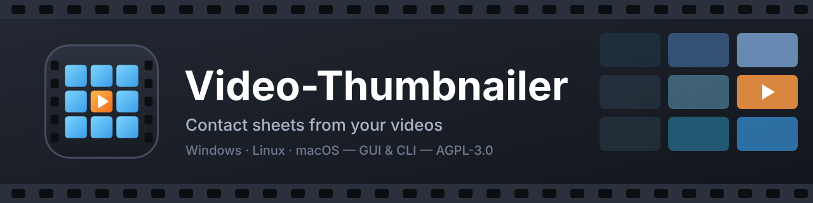</p>

<p align="center">
  <a href="https://github.com/vulture20/Video-Thumbnailer/releases/latest"></a>
  <a href="https://github.com/vulture20/Video-Thumbnailer/releases"></a>
  
  <a href="LICENSE"></a>
</p>

# Video-Thumbnailer

**Contact sheets (thumbnail sheets) from videos – fast, good-looking and free.** Drop in a folder full of films, series or recordings and get one overview picture per video: with the video data in a header, a time stamp in every tile and, if you like, animated, as a trailer clip or as an overview of a whole season. With a graphical interface and a full command line for **Windows, Linux and macOS**.

🇩🇪 *Kostenloser Generator für Video-Kontaktbögen mit Oberfläche und Kommandozeile – [README auf Deutsch](README.md).*

<p align="center">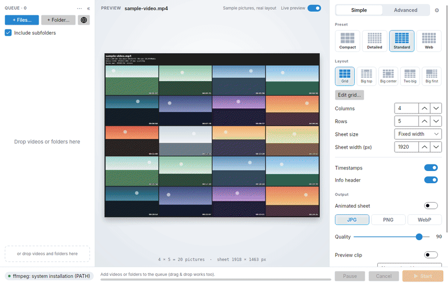</p>

**Contents:** [Highlights](#highlights) · [Examples](#examples) · [Interface](#interface) · [Installation](#installation) · [Quick start](#quick-start) · [Command line](#command-line) · [Keyboard shortcuts](#keyboard-shortcuts) · [FAQ](#faq) · [More details](#more-details) · [ffmpeg](#ffmpeg) · [Building](#building) · [License](#license)

**More docs (German):** [Recipes for common tasks](docs/rezepte.md) · [Preset format](docs/presets.md) · [Sidecar file `.vtsheet`](docs/vtsheet.md) · [Changelog](CHANGELOG.md)

## Highlights

- 🎞️ **Every format ffmpeg knows** – MP4, MKV, AVI, MOV, WebM, WMV, TS …, also 10 bit/HDR, AV1, rotated and anamorphic videos, even **straight from a web server** by URL, without downloading.
- 👀 **Live preview with real pictures** – every setting shows right away exactly as it will look in the result.
- 🧩 **Any grid you like** – columns × rows, special grids with big tiles, a grid editor of its own, fitting to the screen size.
- 🧠 **Good pictures instead of black frames** – fades and cuts are replaced automatically by a frame shortly before or after; capture times can also be chosen by hand.
- 🎨 **Styling** – info header with the video data of your choice, time stamps, colours, background picture, borders, shadows, rounded corners, greyscale, watermark.
- 🎬 **Moving sheets and trailers** – every tile plays a clip (MP4, WebM, GIF, WebP …), or a short preview clip from several places of the video.
- 📚 **Many videos at once** – queue with pause, parallel processing on all cores, pack picture of a whole season, video data as CSV/XML.
- ▶️ **Viewer** – a click on a tile starts the video at exactly that point in mpv, VLC, MPC-HC or PotPlayer.
- 🔒 **Clean** – ffmpeg is downloaded on request and checked by SHA-256, presets are open JSON files, portable mode for a USB stick.

## Examples

All pictures on this page were made by the program itself (from a demo video of ffmpeg test patterns, see [Building](#building)).

<p align="center">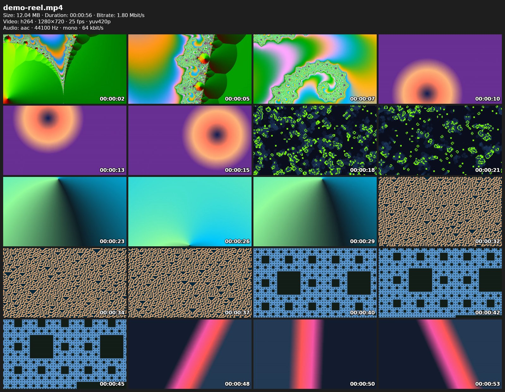<br><b>Standard sheet</b> – <code>vthumb film.mkv</code></p>

<table>
<tr>
<td width="50%">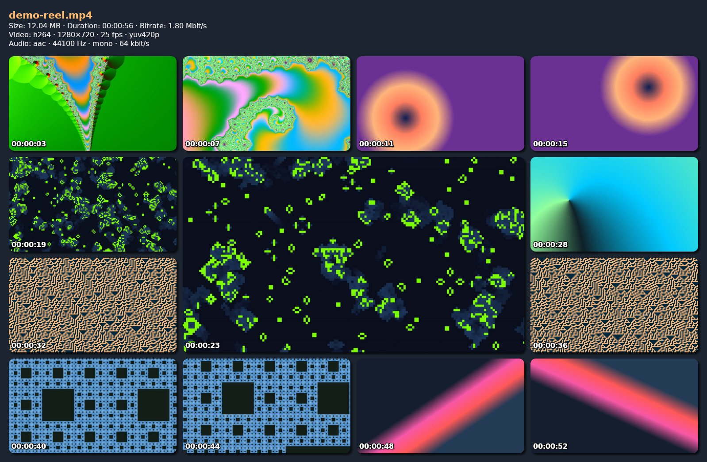</td>
<td width="50%">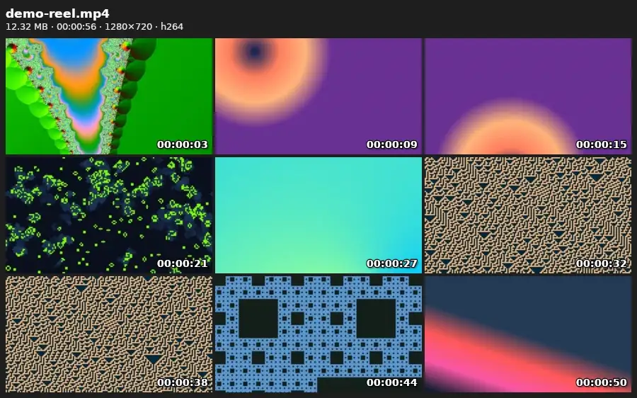</td>
</tr>
<tr>
<td><b>Special grid and effects</b><br><code>vthumb --layout big-center --corners rounded --tile-shadow --gap 14 --background "#1B2430" film.mkv</code></td>
<td><b>Animated sheet</b> – every tile plays 2 seconds<br><code>vthumb -p Compact -a webp --clip-seconds 2 film.mkv</code></td>
</tr>
<tr>
<td colspan="2">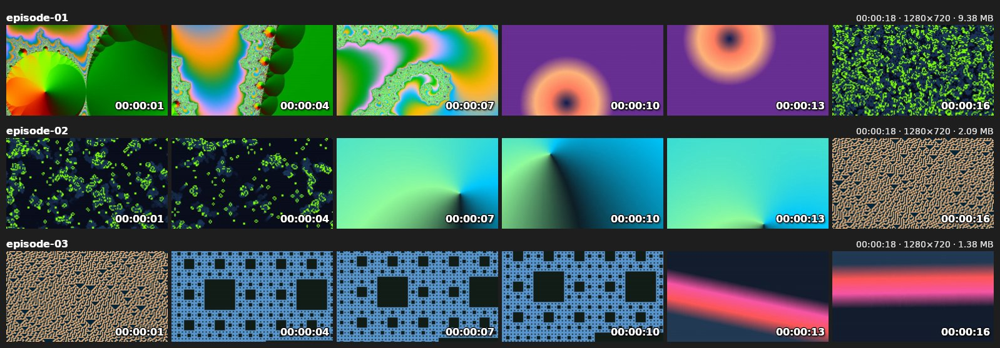</td>
</tr>
<tr>
<td colspan="2"><b>Pack picture</b> – one row per video, e.g. for a whole season<br><code>vthumb pack --tiles 6 -o season.jpg ~/Series/Season1</code></td>
</tr>
</table>

## Interface

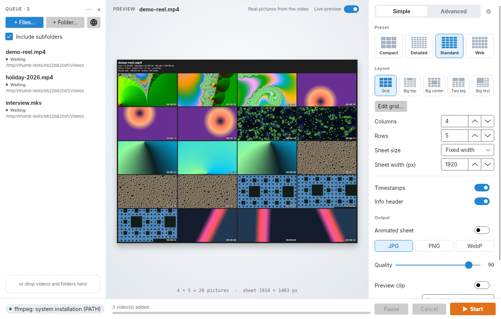

<table>
<tr>
<td width="50%">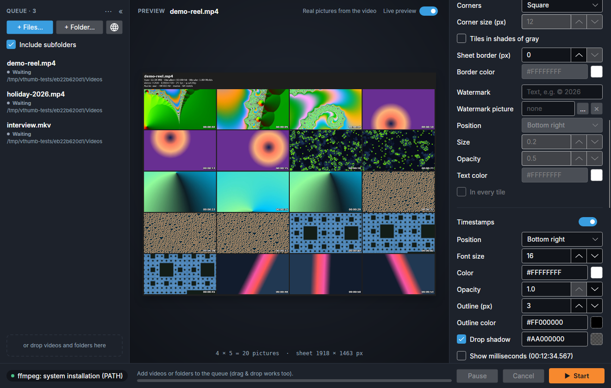</td>
<td width="50%">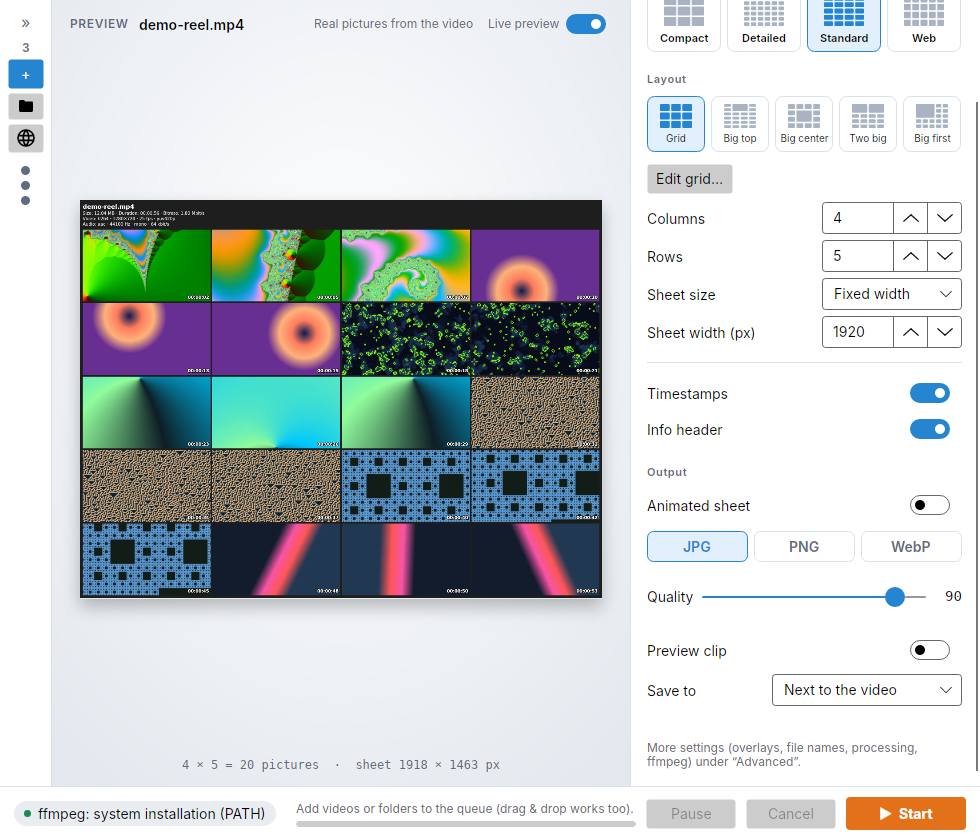</td>
</tr>
<tr>
<td>"Advanced" mode in dark theme: all settings, colour fields with colour picker</td>
<td>Narrow window: the queue folds into a bar</td>
</tr>
<tr>
<td>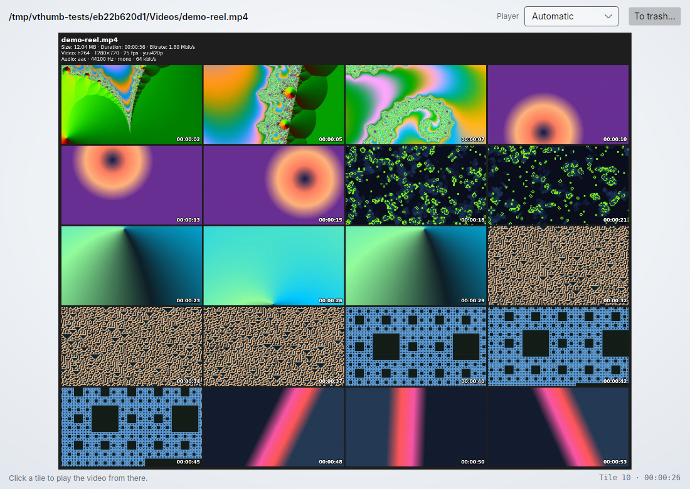</td>
<td>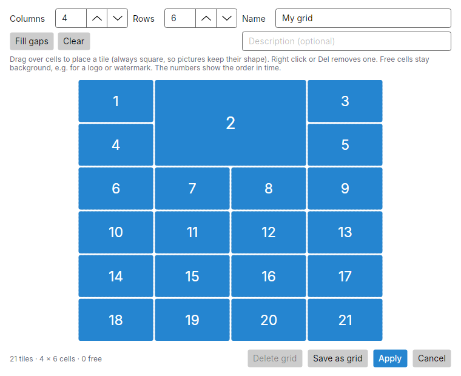</td>
</tr>
<tr>
<td>Viewer: a click on a tile plays the video from that point</td>
<td>Grid editor: own arrangements of big and small tiles</td>
</tr>
</table>

The interface is available in English and German (follows the system language, switchable in the gear menu), light, dark or like the system.

## Installation

Ready-made programs are under **[Releases](https://github.com/vulture20/Video-Thumbnailer/releases/latest)**. No .NET needs to be installed; on first start the program offers to download ffmpeg itself (or uses one that is already there).

<details open>
<summary><b>Windows</b> (x64 or arm64)</summary>

1. Download and run `Video-Thumbnailer-…-win-x64-setup.exe` (or `win-arm64`). No administrator rights needed; the installer adds a start menu entry and, if you like, associates `.vtpreset`, `.vtsheet` and `.vtgrid`.
2. The installer is not signed: if SmartScreen warns, click "More info" → "Run anyway".
3. The command line tool `vthumb.exe` is in the program folder.
</details>

<details open>
<summary><b>Linux</b> (x64 or arm64)</summary>

```bash
chmod +x Video-Thumbnailer-*-linux-x64.AppImage
./Video-Thumbnailer-*-linux-x64.AppImage             # interface
./Video-Thumbnailer-*-linux-x64.AppImage vthumb --help  # command line
```

For the start menu and file associations integrate the AppImage (e.g. with AppImageLauncher) or set up the ZIP version as described in [packaging/linux/README.md](packaging/linux/README.md).
</details>

<details open>
<summary><b>macOS</b> (Apple Silicon or Intel)</summary>

1. Open `…-osx-arm64.dmg` (Apple Silicon) or `…-osx-x64.dmg` (Intel) and drag the app to "Applications".
2. The app is not notarised: on first start right-click → "Open" and confirm.
3. The command line tool is `Video-Thumbnailer.app/Contents/MacOS/vthumb`, e.g. `ln -s /Applications/Video-Thumbnailer.app/Contents/MacOS/vthumb /usr/local/bin/vthumb`.
</details>

<details>
<summary><b>Portable</b> (all systems, ZIP)</summary>

`…-<system>.zip` contains `VideoThumbnailer` (interface) and `vthumb` (command line) as single files, plus `LICENSE`, `README.md` and `licenses/`. If an empty file `portable.txt` lies next to the program file, settings, presets and ffmpeg are stored in the folder `data` next to it – ideal for a USB stick. The environment variable `VIDEO_THUMBNAILER_HOME=<folder>` does the same.
</details>

The checksums of all files are in `checksums.sha256` in the release. Otherwise settings and presets are stored in `%APPDATA%\VideoThumbnailer` (Windows), `~/.config/video-thumbnailer` (Linux) or `~/Library/Application Support/VideoThumbnailer` (macOS).

## Quick start

**Interface:** drag videos or folders into the window (or <kbd>Ctrl</kbd>+<kbd>O</kbd>), choose a preset on the right and check it in the preview, then <kbd>Ctrl</kbd>+<kbd>Enter</kbd>. By default the sheets go next to the videos.

**Command line:**

```bash
vthumb film.mkv                       # one sheet next to the video: film.jpg
vthumb -p Compact -o ~/Sheets ~/Videos  # all videos of a folder (recursive), sheets to ~/Sheets
vthumb --help                         # all options
```

## Command line

```text
vthumb [options] <file|folder|URL>...
vthumb pack [options] <file|folder>... -o <picture.jpg|png|webp>
vthumb presets list|show|import|export|delete
vthumb ffmpeg status|check|install|update|uninstall
```

Without `--preset` the settings last used in the interface apply (otherwise "Standard"). **Every setting of a preset can be changed by an option**; options are applied to the preset in the order given. Values also work as `--option=value`. Colours as `#RRGGBB` or `#AARRGGBB` (AA = opacity), opacities and sizes as `0–1` or in percent.

### Examples

```bash
# All videos of a folder (recursive), sheets next to the videos
vthumb ~/Videos

# Preset "Compact", 6 columns, WebP, everything into one folder with the same sub folder structure
vthumb -p Compact --columns 6 -f webp -o ~/Sheets --keep-structure ~/Videos

# Only show what would happen
vthumb --dry-run ~/Videos

# Animated sheet: every tile plays 3 seconds, as MP4 (or h265, webm, ogv, gif, webp, apng)
vthumb -a mp4 --clip-seconds 3 --fps 10 film.mkv     # -> film.sheet.mp4

# H.265 video with the sound of the biggest tile
vthumb -a h265 --audio --layout big-center film.mkv

# Yellow time stamps with red outline and milliseconds, green title in the info header
vthumb --timestamp-color "#FFFF00" --outline-color "#FF0000" --milliseconds --title-color "#00FF00" film.mkv

# Video straight from a web server (only the needed parts are loaded), sheet to ~/Sheets
vthumb -o ~/Sheets "https://example.org/videos/talk.mp4"

# Capture times by hand: tile 1 at 1:00, tile 2 automatic, tile 3 at 5:30 (clip 2 s long)
vthumb --columns 3 --rows 1 --times "1:00,-,5:30+2" film.mkv

# Big picture in the middle, sheet sized to fit entirely on a 2560×1440 screen
vthumb --layout big-center --fit-screen both --screen 2560x1440 film.mkv

# Background picture, dimmed (opacity 40 % over a dark background)
vthumb --background-image ~/Pictures/cinema.jpg --background-opacity 40 film.mkv

# Rounded tiles with light border and shadow, greyscale, comment and watermark
vthumb --gap 12 --corners rounded --tile-border 2 --tile-border-color "#E6E6E6" --tile-shadow --grayscale \
       --comment "Holiday 2026" --watermark "© 2026" --watermark-opacity 0.4 film.mkv

# Logo as watermark in every tile, top left, a tenth of the tile width
vthumb --watermark-image logo.png --watermark-per-tile --watermark-pos top-left --watermark-size 0.1 film.mkv

# Preview clip: 12 parts of 2.5 s with cross-fade as "film.preview.mp4" next to the sheet
vthumb --trailer mp4 film.mkv

# Only a GIF clip without sheet: 8 parts of 1.5 s, 480 px, hard cuts
vthumb --trailer gif --trailer-only --trailer-clips 8 --trailer-seconds 1.5 --trailer-size 480 --trailer-fade 0 film.mkv

# Data of all videos of a folder as a table, no sheets
vthumb --export-info videos.csv --info-only ~/Videos

# Sheet plus WebVTT thumbnails for a web player (film.thumbnails.vtt and film.thumbnails.jpg)
vthumb --webvtt --columns 10 --rows 10 film.mp4

# Sheet with sidecar file for the viewer (a click on a tile plays the video there)
vthumb --sidecar film.mkv

# Pack picture of a season: 8 pictures per episode, 2400 px wide
vthumb pack ~/Series/Season1 -o ~/season1.jpg --tiles 8 -w 2400

# Save own settings as a preset and pass it on
vthumb --columns 5 --rows 6 --no-header --save-preset "5x6 no header"
vthumb presets export "5x6 no header" 5x6.vtpreset
```

### All commands and options

<!-- The tables between the markers are written by ReadmeTests from src/VideoThumbnailer.Cli/CliOptions.cs:
     VTHUMB_UPDATE_README=1 dotnet test --filter ReadmeTests -->
<!-- cli-options:start -->
| Call | Purpose |
|---|---|
| `vthumb [options] <file\|folder\|URL>…` | Create sheets (default). |
| `vthumb pack [options] <file\|folder>… -o <picture.jpg>` | One overview picture of many videos, a row per video. `-c`/`--tiles` = pictures per video, `-w` = width; all sheet options apply. |
| `vthumb presets list` | All presets with a short description and their folder. |
| `vthumb presets show <name>` | Print a preset as JSON. |
| `vthumb presets export <name> <file>` | Save a preset as `.vtpreset` (to pass it on). |
| `vthumb presets import <file>` | Add a preset from a file. |
| `vthumb presets delete <name>` | Delete an own preset. |
| `vthumb ffmpeg status` | Shows which ffmpeg is used. |
| `vthumb ffmpeg check` | Looks for a newer pinned ffmpeg build. |
| `vthumb ffmpeg install\|update [--force] [--latest]` | Download or update ffmpeg (`--latest`: newest build instead of the pinned one). |
| `vthumb ffmpeg uninstall` | Remove the downloaded ffmpeg. |
| `vthumb --help \| --version` | Show help or version. |

#### Input and processing

| Option | Value | Meaning | Example |
|---|---|---|---|
| `-r`<br>`--recursive`<br>`--no-recursive` |  | Scan sub folders (default: on) or only the given folders. | `vthumb --no-recursive ~/Videos` |
| `-n`<br>`--dry-run` |  | Only list the videos found and where their sheets would go; create nothing. | `vthumb -n ~/Videos` |
| `-j`<br>`--jobs` | `<n>` | At most this many ffmpeg processes at once (default: number of CPU cores). | `vthumb -j 4 ~/Videos` |
| `--videos` | `<n>` | At most this many videos at once. | `vthumb --videos 2 ~/Videos` |
| `--ffmpeg` | `<folder>` | Use ffmpeg and ffprobe from this folder. | `vthumb --ffmpeg /opt/ffmpeg/bin film.mkv` |
| `-y`<br>`--yes` |  | Download ffmpeg without asking if it is missing (for scripts). | `vthumb -y film.mkv` |
| `--quiet` |  | Only print errors and the summary. | `vthumb --quiet ~/Videos` |
| `--lang` | `de\|en\|auto` | Language of help and messages (also environment variable `VTHUMB_LANG`). | `vthumb --lang en ~/Videos` |
| `--sheet-lang` | `de\|en\|auto` | Language of the texts in the sheet (e.g. "Size:"/"Größe:", decimal comma). | `vthumb --sheet-lang en film.mkv` |

#### Preset and grid

| Option | Value | Meaning | Example |
|---|---|---|---|
| `-p`<br>`--preset` | `<name\|file>` | Preset by name or as a `.vtpreset` file. Without it the settings last used in the GUI apply. | `vthumb -p Compact film.mkv` |
| `--save-preset` | `<name>` | Save the settings of this call as a preset. | `vthumb -c 5 --rows 6 --save-preset "5x6"` |
| `--description` | `<text>` | Description of the preset saved with `--save-preset`. | `vthumb -c 5 --save-preset Breit --description "5 Spalten"` |
| `-c`<br>`--columns` | `<n>` | Tiles per row. | `vthumb -c 6 film.mkv` |
| `--rows` | `<n>` | Number of rows. | `vthumb --rows 8 film.mkv` |
| `-w`<br>`--width` | `<px>` | Total width of the sheet; the tile height follows from the aspect ratio. | `vthumb -w 2560 film.mkv` |
| `--tile-width` | `<px>` | Fixed width of each tile (instead of `--width`). | `vthumb --tile-width 320 film.mkv` |
| `--layout` | `<grid\|name\|file>` | Special grid: `big-top`, `big-center`, `two-big`, `big-first`, an own grid from the editor or a `.vtgrid` file; `grid` = plain grid. | `vthumb --layout big-center film.mkv` |
| `--fit-screen` | `off\|width\|both` | Sheet as wide as the screen (`width`) or as large as fits on it entirely (`both`). | `vthumb --fit-screen both film.mkv` |
| `--screen` | `<WxH>` | Screen size for `--fit-screen` (default: the screen the GUI was last on). | `vthumb --fit-screen both --screen 2560x1440 film.mkv` |
| `--gap` | `<px>` | Gap between the tiles. | `vthumb --gap 12 film.mkv` |
| `--margin` | `<px>` | Margin around the whole sheet. | `vthumb --margin 24 film.mkv` |
| `--order` | `row\|column\|random` | Order of the tiles: by rows, by columns or random. | `vthumb --order column film.mkv` |
| `--portrait-swap`<br>`--no-portrait-swap` |  | Swap columns and rows for portrait videos (default) or keep them. | `vthumb --no-portrait-swap handy.mp4` |

#### Capture times

| Option | Value | Meaning | Example |
|---|---|---|---|
| `--skip-start` | `<%>` | Leave out this share at the start of the video (intro). | `vthumb --skip-start 5 film.mkv` |
| `--skip-end` | `<%>` | Leave out this share at the end (credits). | `vthumb --skip-end 8 film.mkv` |
| `--times` | `<list>` | Capture times by hand, one per tile in timeline order: seconds, `mm:ss` or `hh:mm:ss`; `-` = automatic, `+s` = clip length of animated sheets. | `vthumb -c 3 --rows 1 --times "1:00,-,5:30+2" film.mkv` |
| `--skip-black`<br>`--no-skip-black` |  | Replace black or one-coloured frames by a good one shortly before or after (default: on). | `vthumb --no-skip-black film.mkv` |
| `--black-search` | `<s>` | Look this many seconds before and after the time for a good frame (default 2). | `vthumb --black-search 5 film.mkv` |

#### Background, tiles and borders

| Option | Value | Meaning | Example |
|---|---|---|---|
| `--background` | `<color>` | Background colour as `#RRGGBB` or `#AARRGGBB`. | `vthumb --background "#101820" film.mkv` |
| `--background-image` | `<file\|none>` | Picture behind the tiles. | `vthumb --background-image kino.jpg film.mkv` |
| `--background-mode` | `fill\|stretch\|tile\|center` | Fill, stretch, tile or center the background picture (default `fill`). | `vthumb --background-mode tile film.mkv` |
| `--background-opacity` | `<0–1 or %>` | How strongly the picture shows over the background colour (default 0.5). | `vthumb --background-opacity 40 film.mkv` |
| `--font` | `<family>` | Font of the info header and the time stamps. | `vthumb --font "DejaVu Sans" film.mkv` |
| `--tile-border`<br>`--no-tile-border` | `<px>` | Line inside the edge of each tile, or none. | `vthumb --tile-border 2 film.mkv` |
| `--tile-border-color` | `<color>` | Colour of the tile line. | `vthumb --tile-border 2 --tile-border-color "#E6E6E6" film.mkv` |
| `--tile-shadow`<br>`--no-tile-shadow` |  | Drop shadow behind each tile (falls into the gap, so set `--gap`). | `vthumb --gap 12 --tile-shadow film.mkv` |
| `--tile-shadow-color` | `<color>` | Colour of the shadow (turns it on). | `vthumb --tile-shadow-color "#80000000" film.mkv` |
| `--tile-shadow-offset` | `<px>` | Offset of the shadow to the bottom right (default 4). | `vthumb --tile-shadow-offset 6 film.mkv` |
| `--tile-shadow-blur` | `<px>` | Softness of the shadow (default 4). | `vthumb --tile-shadow-blur 8 film.mkv` |
| `--grayscale`<br>`--no-grayscale` |  | Tiles in shades of grey. | `vthumb --grayscale film.mkv` |
| `--corners` | `square\|rounded\|cut` | Corners of the tiles: square, rounded or cut. | `vthumb --corners rounded film.mkv` |
| `--corner-radius` | `<px>` | Radius of rounded or size of cut corners (default 12). | `vthumb --corners rounded --corner-radius 20 film.mkv` |
| `--sheet-border`<br>`--no-sheet-border` | `<px>` | Line around the whole sheet (inside the margin), or none. | `vthumb --margin 16 --sheet-border 3 film.mkv` |
| `--sheet-border-color` | `<color>` | Colour of the line around the sheet. | `vthumb --sheet-border 3 --sheet-border-color "#FFD700" film.mkv` |

#### Time stamps

| Option | Value | Meaning | Example |
|---|---|---|---|
| `--timestamps`<br>`--no-timestamps` |  | Show the time stamp in each tile, or leave it out. | `vthumb --no-timestamps film.mkv` |
| `--timestamp-pos` | `top-left\|top-right\|bottom-left\|bottom-right\|center` | Position of the time stamp in the tile. | `vthumb --timestamp-pos top-left film.mkv` |
| `--timestamp-size` | `<pt>` | Font size of the time stamp. | `vthumb --timestamp-size 18 film.mkv` |
| `--timestamp-bold`<br>`--no-timestamp-bold` |  | Time stamp bold or regular. | `vthumb --no-timestamp-bold film.mkv` |
| `--timestamp-color` | `<color>` | Text colour of the time stamp. | `vthumb --timestamp-color "#FFFF00" film.mkv` |
| `--timestamp-opacity` | `<0–1 or %>` | Opacity of the time stamp. | `vthumb --timestamp-opacity 70 film.mkv` |
| `--timestamp-padding` | `<px>` | Distance of the time stamp from the tile edge. | `vthumb --timestamp-padding 10 film.mkv` |
| `--outline-color` | `<color>` | Colour of the outline around the digits. | `vthumb --outline-color "#FF0000" film.mkv` |
| `--outline-width`<br>`--no-outline` | `<px>` | Width of the outline, or no outline. | `vthumb --outline-width 3 film.mkv` |
| `--shadow`<br>`--no-shadow` |  | Shadow under the time stamp. | `vthumb --no-shadow film.mkv` |
| `--shadow-color` | `<color>` | Colour of the time stamp shadow (turns it on). | `vthumb --shadow-color "#000000" film.mkv` |
| `--shadow-offset` | `<px>` | Offset of the time stamp shadow. | `vthumb --shadow-offset 2 film.mkv` |
| `--milliseconds`<br>`--no-milliseconds` |  | Time with milliseconds, e.g. `00:12:34.567`. | `vthumb --milliseconds film.mkv` |

#### Info header and comment

| Option | Value | Meaning | Example |
|---|---|---|---|
| `--header`<br>`--no-header` |  | Show the info header with the video data, or leave it out. | `vthumb --no-header film.mkv` |
| `--header-pos` | `top-left\|top-right\|bottom-left\|bottom-right` | Place of the info header. | `vthumb --header-pos bottom-left film.mkv` |
| `--header-template` | `<template>` | Lines of the info header with placeholders like `{filename}`, `{size:GB}`, `{duration}`; `\n` for a new line. | `vthumb --header-template "{filename}\n{size:GB} · {duration} · {resolution}" film.mkv` |
| `--title-size` | `<pt>` | Font size of the title line. | `vthumb --title-size 28 film.mkv` |
| `--header-size` | `<pt>` | Font size of the other lines. | `vthumb --header-size 16 film.mkv` |
| `--title-color` | `<color>` | Colour of the title line. | `vthumb --title-color "#00FF00" film.mkv` |
| `--header-color` | `<color>` | Colour of the other lines. | `vthumb --header-color "#CCCCCC" film.mkv` |
| `--line-spacing` | `<factor>` | Line spacing in the info header (default 1.25). | `vthumb --line-spacing 1.5 film.mkv` |
| `--comment`<br>`--no-comment` | `<text>` | Own text below the info header (or where the template has `{comment}`), `\n` for more lines. | `vthumb --comment "Urlaub 2026" film.mkv` |

#### Watermark

| Option | Value | Meaning | Example |
|---|---|---|---|
| `--watermark` | `<text>` | Text as watermark. | `vthumb --watermark "© 2026" film.mkv` |
| `--watermark-image` | `<file\|none>` | Picture (e.g. PNG with transparency) as watermark; wins over the text. | `vthumb --watermark-image logo.png film.mkv` |
| `--no-watermark` |  | No watermark (even if the preset has one). | `vthumb -p Web --no-watermark film.mkv` |
| `--watermark-pos` | `top-left\|top-right\|bottom-left\|bottom-right\|center\|tiled` | Corner, center or repeated over the whole area. | `vthumb --watermark "Demo" --watermark-pos tiled film.mkv` |
| `--watermark-size` | `<0–1 or %>` | Width relative to the sheet or tile (default 0.2). | `vthumb --watermark "Demo" --watermark-size 0.1 film.mkv` |
| `--watermark-opacity` | `<0–1 or %>` | Opacity (default 0.5). | `vthumb --watermark "Demo" --watermark-opacity 0.4 film.mkv` |
| `--watermark-color` | `<color>` | Colour of the text watermark. | `vthumb --watermark "Demo" --watermark-color "#FFFFFF" film.mkv` |
| `--watermark-per-tile`<br>`--watermark-sheet` |  | Watermark in every tile, or once over the whole sheet. | `vthumb --watermark "Demo" --watermark-per-tile film.mkv` |

#### Output

| Option | Value | Meaning | Example |
|---|---|---|---|
| `-f`<br>`--format` | `jpg\|png\|webp` | Picture format of the sheet. | `vthumb -f webp film.mkv` |
| `-q`<br>`--quality` | `<1–100>` | Quality for JPG and WebP. | `vthumb -q 80 film.mkv` |
| `-o`<br>`--output` | `<folder>` | Write all sheets into this folder. | `vthumb -o ~/Sheets ~/Videos` |
| `--keep-structure`<br>`--no-keep-structure` |  | With `-o`: recreate the folder structure of the input. | `vthumb -o ~/Sheets --keep-structure ~/Videos` |
| `--next-to-video` |  | Write each sheet next to its video (default). | `vthumb --next-to-video ~/Videos` |
| `--subfolder` | `<name>` | Write the sheet into a sub folder next to the video. | `vthumb --subfolder sheets ~/Videos` |
| `--pattern` | `<pattern>` | File name with `{name}` `{ext}` `{preset}` `{cols}` `{rows}` `{date}` `{time}`. | `vthumb --pattern "{name}_{cols}x{rows}" film.mkv` |
| `--overwrite` | `skip\|overwrite\|rename` | What happens to existing sheets. | `vthumb --overwrite rename film.mkv` |
| `--frames`<br>`--no-frames` |  | Also save every captured frame as its own picture. | `vthumb --frames film.mkv` |
| `--frames-folder` | `<pattern>` | Folder of the single frames, relative to the sheet (default `{name}_frames`). | `vthumb --frames-folder "{name}-bilder" film.mkv` |

#### Animated sheet

| Option | Value | Meaning | Example |
|---|---|---|---|
| `-a`<br>`--animated` | `mp4\|h265\|webm\|ogv\|gif\|webp\|apng` | Animated sheet: each tile plays a short clip from its time on. | `vthumb -a webp film.mkv` |
| `--still` |  | Still picture even if the preset is animated. | `vthumb -p MeinAnimiertes --still film.mkv` |
| `--clip-seconds` | `<s>` | Length of each clip (default 3). | `vthumb -a mp4 --clip-seconds 5 film.mkv` |
| `--fps` | `<n>` | Frames per second of the animation (default 10). | `vthumb -a gif --fps 8 film.mkv` |
| `--audio`<br>`--no-audio` |  | Sound of the biggest (or first) tile; only for mp4, h265, webm, ogv. | `vthumb -a h265 --audio --layout big-center film.mkv` |

#### Preview clip (trailer)

| Option | Value | Meaning | Example |
|---|---|---|---|
| `--trailer`<br>`--no-trailer` | `mp4\|h265\|webm\|ogv\|gif\|webp\|apng` | Also write a clip of short parts (`<name>.preview.<ext>`). | `vthumb --trailer mp4 film.mkv` |
| `--trailer-only`<br>`--with-sheet` |  | Only the clip, no sheet, or both. | `vthumb --trailer gif --trailer-only film.mkv` |
| `--trailer-clips` | `<n>` | Number of parts (default 12). | `vthumb --trailer mp4 --trailer-clips 8 film.mkv` |
| `--trailer-seconds` | `<s>` | Length of each part (default 2.5; the clip stays within 2 minutes). | `vthumb --trailer mp4 --trailer-seconds 1.5 film.mkv` |
| `--trailer-fade` | `<s>` | Cross-fade between the parts, 0 = hard cut (default 0.5). | `vthumb --trailer mp4 --trailer-fade 0 film.mkv` |
| `--trailer-size` | `<px>` | Longer side of the picture (default 640). | `vthumb --trailer gif --trailer-size 480 film.mkv` |
| `--trailer-fps` | `<n>` | Frames per second (default 24). | `vthumb --trailer webm --trailer-fps 30 film.mkv` |
| `--trailer-timestamps`<br>`--no-trailer-timestamps` |  | Time of each part in the corner (default: on). | `vthumb --trailer mp4 --no-trailer-timestamps film.mkv` |
| `--trailer-audio`<br>`--no-trailer-audio` |  | Sound of the parts (mp4, h265, webm, ogv). | `vthumb --trailer mp4 --trailer-audio film.mkv` |

#### Companion files and video data

| Option | Value | Meaning | Example |
|---|---|---|---|
| `--sidecar`<br>`--no-sidecar` |  | Sidecar file `<name>.vtsheet` with the time and rectangle of every tile, for the viewer. | `vthumb --sidecar film.mkv` |
| `--webvtt`<br>`--no-webvtt` |  | WebVTT thumbnails for web players: `<name>.thumbnails.vtt` and sprite `<name>.thumbnails.jpg`. | `vthumb --webvtt -c 10 --rows 10 film.mp4` |
| `--webvtt-width` | `<px>` | Width of one picture in the sprite (default 160). | `vthumb --webvtt-width 240 film.mp4` |
| `--export-info` | `<file.csv\|file.xml>` | Technical data of all videos as a CSV or XML table (a row per video). | `vthumb --export-info videos.csv ~/Videos` |
| `--info-only` |  | With `--export-info`: only the table, no sheets. | `vthumb --export-info videos.xml --info-only ~/Videos` |
<!-- cli-options:end -->

**Language:** without `--lang` the language chosen in the interface applies, otherwise the system language.
**Exit codes:** `0` ok · `1` some videos failed · `2` usage error · `3` ffmpeg missing · `130` cancelled.

### Placeholders

In the **info header** (`--header-template`, in the interface under "Advanced"):

`{filename}` `{name}` `{ext}` `{folder}` `{path}` `{title}` `{container}` `{size}` `{size:B|KB|MB|GB|TB}` `{duration}` `{bitrate}`
`{width}` `{height}` `{resolution}` `{vcodec}` `{vprofile}` `{fps}` `{pixfmt}` `{hdr}` `{vbitrate}` `{rotation}`
`{audio}` `{acodec}` `{samplerate}` `{channels}` `{channellayout}` `{abitrate}` `{alang}` `{audiotracks}`
`{subtitles}` `{slang}` `{subtracks}` `{comment}`

The first line is drawn bold and larger. `{comment}` is the own comment text; if it is not in the template, the comment is added as the last line(s).

In the **file name** (`--pattern`): `{name}` `{ext}` `{preset}` `{cols}` `{rows}` `{date}` `{time}`

## Keyboard shortcuts

The shortcuts are also shown in the tooltips of the buttons. On macOS <kbd>⌘</kbd> replaces <kbd>Ctrl</kbd>.

<!-- shortcuts:start -->
| Windows / Linux | macOS | Action |
|---|---|---|
| <kbd>Ctrl+O</kbd> | <kbd>⌘O</kbd> | Add files |
| <kbd>Ctrl+Shift+O</kbd> | <kbd>⇧⌘O</kbd> | Add a folder |
| <kbd>Ctrl+U</kbd> | <kbd>⌘U</kbd> | Add a web address (URL) |
| <kbd>Ctrl+Enter</kbd> or <kbd>F5</kbd> | <kbd>⌘↩</kbd> or <kbd>F5</kbd> | Start |
| <kbd>Ctrl+P</kbd> | <kbd>⌘P</kbd> | Pause / resume |
| <kbd>Esc</kbd> | <kbd>⎋</kbd> | Cancel (while running) |
| <kbd>Ctrl+A</kbd> | <kbd>⌘A</kbd> | Select all queue entries |
| <kbd>Del</kbd> | <kbd>⌫</kbd> | Remove the selected entries from the queue |
| <kbd>Ctrl+R</kbd> | <kbd>⌘R</kbd> | Re-queue the selected finished entries |
| <kbd>Ctrl+E</kbd> | <kbd>⌘E</kbd> | Switch between "Simple" and "Advanced" |
| <kbd>Ctrl+L</kbd> | <kbd>⌘L</kbd> | Live preview on/off |
| <kbd>Ctrl+B</kbd> | <kbd>⌘B</kbd> | Fold/unfold the queue |
| <kbd>Esc</kbd> | <kbd>⎋</kbd> | Viewer: close |
| <kbd>Del</kbd> | <kbd>⌫</kbd> | Viewer: move the video (optionally with its sheet) to the trash |
| <kbd>Del / Backspace</kbd> | <kbd>⌫</kbd> | Grid editor: remove the tile under the mouse (right click too) |
<!-- shortcuts:end -->

Also: a double click on a finished entry opens the sheet in the viewer, a right click on an entry shows its actions, and videos, folders and web addresses can be dragged into the window.

## FAQ

<details>
<summary><b>Windows warns on start ("Windows protected your PC")</b></summary>

Installer and program are not signed, so SmartScreen warns about new versions. Click "More info" → "Run anyway". To be sure, compare the file with `checksums.sha256` from the release (`certutil -hashfile <file> SHA256`).
</details>

<details>
<summary><b>macOS: "cannot be opened because the developer cannot be verified"</b></summary>

The app is not notarised. On first start right-click the app in Finder → "Open" → "Open". Alternatively System Settings → Privacy & Security → "Open Anyway".
</details>

<details>
<summary><b>"ffmpeg not found" or the download fails</b></summary>

The program looks in this order: own folder (settings or `--ffmpeg`), downloaded ffmpeg, `PATH`. Without internet or behind a firewall install ffmpeg yourself (Linux: package manager, macOS: `brew install ffmpeg`, Windows: e.g. `winget install Gyan.FFmpeg`) or give the folder with `ffmpeg` and `ffprobe` in the settings or by `--ffmpeg <folder>`. `vthumb ffmpeg status` shows what was found.
</details>

<details>
<summary><b>Some tiles are black or show intro/credits</b></summary>

Black and one-coloured frames are normally replaced; for long fades widen the search (`--black-search 5` or "Search ± (s)" under "Advanced"). Intro and credits can be left out with `--skip-start`/`--skip-end` (percent). Single tiles can be clicked in the preview to choose their time by hand.
</details>

<details>
<summary><b>A video from a web address loads very slowly or not at all</b></summary>

It is only fast if the server supports range requests; otherwise ffmpeg has to read up to each point. MP4 files with the index at the end cannot be opened at all without range requests. Then download the video and process it locally. After 30 s without data the program gives up.
</details>

<details>
<summary><b>Everything is slow on a network drive</b></summary>

Every tile is a separate read at another place in the video. Over the network it helps to read less in parallel (`-j 2 --videos 1` or "Advanced" → Processing) and to turn off the live preview (<kbd>Ctrl</kbd>+<kbd>L</kbd>) so that pictures are not loaded all the time while adjusting.
</details>

<details>
<summary><b>My media server shows the sheet as the cover</b></summary>

A picture with the same name as the video (`Film.jpg` next to `Film.mkv`) is taken for a cover by some media servers and players. Write the sheets into a sub folder (`--subfolder thumbnails`) or change the name (`--pattern "{name}.sheet"`).
</details>

<details>
<summary><b>Where are settings and presets? How do I take them along?</b></summary>

Windows `%APPDATA%\VideoThumbnailer`, Linux `~/.config/video-thumbnailer`, macOS `~/Library/Application Support/VideoThumbnailer`. Single presets are passed on as `.vtpreset` ([format, German](docs/presets.md)); for a program that goes along completely use the [portable mode](#installation).
</details>

## More details

<details>
<summary><b>Videos by URL</b></summary>

`http://` and `https://` are read directly by ffmpeg. That is fast if the server supports range requests (usual web servers and CDNs do); otherwise ffmpeg must read up to the point, and formats with the index at the end of the file (some MP4) cannot be opened at all. After 30 s without data it gives up. As there is no "next to the video", the sheets go to the output folder; without one, in the interface into the user's pictures folder and on the command line into the current folder. Name, extension and `{folder}`/`{path}` come from the address; user name, password and query parameters (often access keys) do not appear in the sheet. In the interface: the globe button (<kbd>Ctrl</kbd>+<kbd>U</kbd>) or drag the address from the browser into the window.
</details>

<details>
<summary><b>Capture times by hand</b></summary>

In the interface click a tile in the preview and choose the time with the slider, by typing or frame by frame (for animated sheets also the length of the clip). `--times` takes a list, one per tile in timeline order (with "random" therefore not by position): seconds, `mm:ss` or `hh:mm:ss` (with decimals), `-` for automatic, `+s` for the clip length of animated sheets. The list applies to all given videos and is not part of the preset. Times chosen by hand are never replaced as "black". In the interface they apply to the video in the queue and stay until the program is closed.
</details>

<details>
<summary><b>Special grids and grid editor</b></summary>

Built in are `big-top` (big picture on top, 21 pictures), `big-center` (big picture in the middle, 13), `two-big` (two big ones on top, 14) and `big-first` (first picture big at the top left, 17). Own templates are stored in the preset under `template` or in a JSON file of their own for `--layout`: a grid of `columns` × `rows` cells in the aspect ratio of the video and on it the tiles with their top left cell and size in cells (always square so that no picture is distorted); cells without a tile stay free. The capture times run by the top left cell of each tile, by rows or by columns.

```json
{ "name": "Widescreen", "columns": 3, "rows": 3,
  "tiles": [ { "x": 0, "y": 0, "size": 2 }, { "x": 2, "y": 0 }, { "x": 2, "y": 1 },
             { "x": 0, "y": 2 }, { "x": 1, "y": 2 }, { "x": 2, "y": 2 } ] }
```

"Edit grid…" below the layout choice opens the current grid (or the plain grid) on a cell grid in the aspect ratio of the video. Dragging over cells places a square tile, right click or <kbd>Del</kbd> removes one, "Fill gaps" puts small tiles into free cells; empty cells stay background, e.g. for a logo. "Apply" uses the grid only in the current settings (and in the preset), "Save as grid" also stores `<name>.vtgrid` in the settings folder (`grids`). Saved grids appear next to the built-in ones, work on the command line with `--layout <name>` and can be passed on as files (a double click adds them).
</details>

<details>
<summary><b>Fit to screen</b></summary>

In the interface the screen the window is on counts (usable area without taskbar, in physical pixels). The command line takes `--screen WxH`, otherwise the screen last seen by the interface, otherwise the fixed width of the preset.
</details>

<details>
<summary><b>Background, tile effects and watermark</b></summary>

**Background and watermark picture:** relative paths in a preset file are relative to its folder; on export a picture in the same folder is stored relative, so that preset and picture can be passed on together.

**Tile effects:** the border is drawn inside the tile, so the picture size does not change. The shadow falls into the gap between the tiles; without a gap it is hardly visible (rule of thumb: gap about as large as offset plus softness, default 4 px each). The sheet border lies in the margin. Single frames (`--frames`) stay unchanged.

**Watermark:** a picture wins over the text. The size is the width of the watermark relative to the sheet width (with `--watermark-per-tile` to the tile width), at most as high as the area. It lies above the info header, in tiles below the time stamp. Single frames get no watermark.
</details>

<details>
<summary><b>Animated sheets and preview clip</b></summary>

**Formats:** MP4 (H.264) plays everywhere; H.265 is smaller but not every browser plays it. WebP and GIF suit web pages and forums, APNG is lossless and correspondingly large, OGV (Theora) exists for older free environments. With `--audio` ("With sound") the sound of the biggest tile plays during its clip, with tiles of equal size that of the first; GIF, WebP and APNG cannot contain sound.

**Preview clip:** the parts are spread evenly over the video (skipping start/end and black frames as for the sheet). Default is 12 parts of 2.5 s with 0.5 s cross-fade, 640 px on the longer side and 24 frames/s, the time stamp in the style of the sheet. If the clip would be longer than 2 minutes, the parts get shorter; a short video only gets as many parts as fit. With `--trailer-audio` the sound of the parts plays along (cross-faded like the picture). The clip is called `<name>.preview.<ext>` and lies next to the sheet; folder scans skip it like `*.sheet.*`.
</details>

<details>
<summary><b>Pack picture</b></summary>

One row per video with name (or title), duration, resolution and size, below as many pictures as the grid has columns (`-c`/`--tiles`), as wide as the sheet (`-w`). Colours, font, time stamps, gaps and skipped start/end come from the settings or the preset. Portrait videos are fitted into the 16:9 area. If the picture is too tall for the format (WebP 16383 px, JPEG 65000 px, PNG 32000 px), `pack-1`, `pack-2` … are written.
</details>

<details>
<summary><b>Sidecar file and viewer</b></summary>

With `--sidecar` ("Sidecar file with tile times") a file `<name>.vtsheet` is written next to the sheet, an open JSON with video, sheet size and the rectangle and time of every tile ([format](docs/vtsheet.md)). The viewer opens it by double click (file or finished queue entry) or via "⋯" → "Open sheet…". A click on a tile starts the video there; the player can be chosen in the viewer: "Automatic" looks for mpv, VLC, MPC-HC/MPC-BE and PotPlayer, "Own command…" takes a command line with `{file}`, `{seconds}`, `{ms}` and `{time}`. The system default knows no start time and opens the video at the beginning. "To trash…" (<kbd>Del</kbd>) moves the video to the trash after asking, optionally with sheet and companion files; if that fails, everything stays where it is. Times chosen by hand are also stored in the sidecar file and come back when the video is added to the queue again.
</details>

<details>
<summary><b>Video data as CSV/XML and WebVTT</b></summary>

**Video data:** one file per run with a row (CSV) or a `<video>` element (XML) per video. The columns are named like the placeholders of the info header (`filename`, `size`, `duration`, `vcodec` …); numbers have no unit and use a point (size in bytes, duration in seconds, bit rates in bit/s), so that spreadsheets and scripts read them in any language. Unreadable files are listed with the reason in the column `error`. CSV with comma (RFC 4180), UTF-8 with BOM. In the interface: "⋯" above the queue → "Export video data…".

**WebVTT:** `<name>.thumbnails.jpg` holds the captured pictures (160 px wide, `--webvtt-width`) in a grid without header, time stamps and effects; `<name>.thumbnails.vtt` maps each time range to a picture (`#xywh=`). Each picture applies up to the middle between it and the next one. For a fine timeline use a preset with many tiles (e.g. 10 × 10).
</details>

<details>
<summary><b>Subtitles</b></summary>

Counted are subtitle tracks in the video and files next to the video with the same name: `Film.srt`, `Film.de.srt`, `Film.en.forced.ass`, `Film.eng.sdh.vtt`, `Film.sup`, `Film.idx` (with `.sub`). Between name and extension only a language code and `forced`, `sdh`, `hi`, `cc` may appear, otherwise the file belongs to another video. `{subtitles}` gives e.g. "3: ger SRT, eng PGS forced, de SRT external". Subtitles are not burnt into the picture.
</details>

<details>
<summary><b>Presets and preset files</b></summary>

Included are the base presets "Compact", "Detailed", "Standard" and "Web"; own presets are open JSON files in the settings folder. Exported presets are called `<name>.vtpreset` (content JSON) and open by double click: the preset is added and selected. If the program is already running, the open window gets the file (as do videos via "Open with"). The Windows installer registers the extension (can be deselected), the macOS DMG as well; for Linux see [packaging/linux/README.md](packaging/linux/README.md). Older `*.vtpreset.json` files can still be imported and opened. All fields: [docs/presets.md](docs/presets.md) (German).
</details>

<details>
<summary><b>Queue: re-queue</b></summary>

Finished queue entries (created, skipped, failed or cancelled) go back to "Waiting" by right click → "Queue again" or <kbd>Ctrl</kbd>+<kbd>R</kbd> (for all selected), by ↻ on the entry (appears on hover) or by "⋯" → "Queue all finished again" or "Retry failed". They keep their place and run at the next start with the current settings; times chosen by hand stay. The existing sheet is replaced, even if existing files are otherwise skipped; with "Keep both (rename)" a new file is written. Not possible during a run.
</details>

## ffmpeg

ffmpeg is not included. If it is missing, the program offers to download it (command line: `-y` or `vthumb ffmpeg install`); an ffmpeg that is already there is found automatically. Search order: own folder (settings or `--ffmpeg`) → downloaded ffmpeg → `PATH`.

| System | Source |
|---|---|
| Windows x64 | [gyan.dev](https://www.gyan.dev/ffmpeg/builds/) (GPL "full_build-shared", via [GyanD/codexffmpeg](https://github.com/GyanD/codexffmpeg/releases)) |
| Linux x64/arm64, macOS arm64/Intel | [ffmpeg.martin-riedl.de](https://ffmpeg.martin-riedl.de) (macOS builds signed and notarised) |
| Windows arm64 | [BtbN/FFmpeg-Builds](https://github.com/BtbN/FFmpeg-Builds) (newest build, see below) |

A **pinned** ffmpeg build from [ffmpeg-pins.json](src/VideoThumbnailer.Core/Ffmpeg/ffmpeg-pins.json) is installed: address and SHA-256 checksum are stored in this repository, not on the download server. On macOS the Apple signature of the publisher is checked as well. The app reads the list from GitHub when checking for updates (without connection the built-in list applies); a weekly workflow adds newer builds there after downloading and checking them. So a new ffmpeg needs no new app version. For Windows arm64 there is no permanently available build; there the newest build is checked against the checksum of the provider. `vthumb ffmpeg install --latest` does that on request on the other systems too.

Details on locations, checksums and updates: [docs/DECISIONS.md](docs/DECISIONS.md) (German).

## Building

Requirement: [.NET 10 SDK](https://dotnet.microsoft.com/download).

```bash
dotnet build
dotnet test                                   # integration tests need ffmpeg in PATH
dotnet run --project src/VideoThumbnailer.Gui
dotnet run --project src/VideoThumbnailer.Cli -- --help

# single file for one platform
dotnet publish src/VideoThumbnailer.Gui -c Release -r linux-x64 --self-contained \
  -p:PublishSingleFile=true -p:IncludeNativeLibrariesForSelfExtract=true -p:EnableCompressionInSingleFile=true
```

**Keeping the README up to date:** the options live in one place, `src/VideoThumbnailer.Cli/CliOptions.cs` (German and English, with example). `vthumb --help` and the tables in `README.md` and `README.en.md` are made from it; the shortcut tables come from `Shortcuts.cs`. A test fails as soon as an option is missing or a README is out of date. Rewrite with `VTHUMB_UPDATE_README=1 dotnet test --filter ReadmeTests`. All pictures in `docs/images` (example sheets, screenshots, `workflow.gif`) are made by `tools/readme-images.sh` (needs ffmpeg).

Structure:

- `src/VideoThumbnailer.Core` – ffmpeg handling, video data, layout, rendering (SkiaSharp), queue, presets
- `src/VideoThumbnailer.Cli` – command line `vthumb`
- `src/VideoThumbnailer.Gui` – interface (Avalonia)
- `tests/VideoThumbnailer.Tests` – unit, integration and GUI tests (headless)
- `assets/branding` – icon and banner (SVG sources, build script `build.py`)
- `packaging/windows`, `packaging/linux`, `packaging/macos` – installer (Inno Setup), AppImage (with `.desktop` file and hicolor icons) and DMG
- `tools/ffmpeg-pins.py` – writes the list of pinned ffmpeg builds
- `tools/readme-images.sh` – makes the pictures of this page

Decisions and open points: [docs/DECISIONS.md](docs/DECISIONS.md) · Changes: [CHANGELOG.md](CHANGELOG.md) · Bugs and ideas: [Issues](https://github.com/vulture20/Video-Thumbnailer/issues)

## License

Copyright (C) 2026 Thorsten Schröpel

[GNU Affero General Public License v3.0](LICENSE).
The included font DejaVu Sans has its own free license (`licenses/DejaVu-LICENSE.txt`).
ffmpeg is not part of this program and is obtained separately under its own license (GPL).
