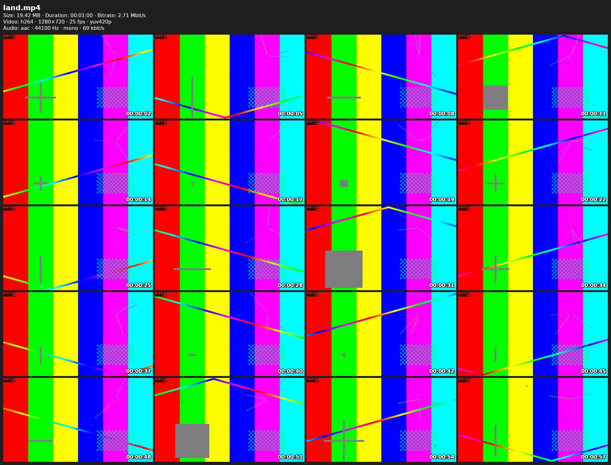
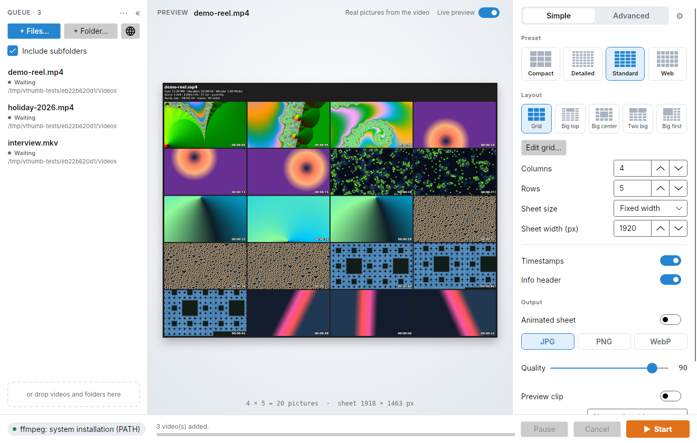

<p align="center"></p>

# Video-Thumbnailer

Freier, plattformübergreifender Generator für Video-Kontaktbögen (Thumbnail-Sheets) für **Windows, Linux und macOS** – mit grafischer Oberfläche und Kommandozeile.
Free, cross-platform video contact sheet generator with GUI and command line.



## Funktionen (v1)

- Einzelne Dateien oder ganze Ordner (rekursiv) per Dialog, Drag & Drop oder Kommandozeile
- Alle Formate, die ffmpeg lesen kann (MP4, MKV, AVI, MOV, WebM, WMV, TS …), inkl. 10-Bit/HDR, AV1, gedrehte und anamorphe Videos
- Raster aus Spalten × Zeilen, Breite, Abstand, Rand; automatische Kachelhöhe, Anpassung für Hochkant-Videos
- Reihenfolge zeilenweise, spaltenweise oder zufällig
- Zeitstempel in jeder Kachel (5 Positionen, Farbe, Deckkraft, Kontur, Schatten)
- Info-Kopf mit frei konfigurierbaren Video-Infos (Name, Größe, Dauer, Auflösung, Codecs, Bitrate, FPS, Audio …)
- Ausgabe als JPG, PNG oder WebP; optional jede Aufnahme als Einzelbild
- Animierte Sheets als MP4, WebM oder GIF: jede Kachel spielt einen kurzen Ausschnitt ab ihrem Zeitpunkt ab, mit mitlaufendem Zeitstempel
- Warteschlange mit Pause, Abbruch, Fortschritt und paralleler Verarbeitung über alle CPU-Kerne
- Ausgabe in einen Ordner (optional mit Ordnerstruktur), neben das Video oder in einen Unterordner; Dateinamen-Muster
- Presets als offene JSON-Dateien, 4 mitgelieferte Basis-Presets
- Oberfläche, Kommandozeile und Texte im Sheet auf Deutsch und Englisch (folgt der Systemsprache, umschaltbar)
- Live-Vorschau des Kontaktbogens beim Einstellen, mit echten Bildern und Videodaten des gewählten Videos: Raster, Info-Kopf, Zeitstempel, Farben und Bildgröße wie im Ergebnis (abschaltbar)
- Einstellungen im Modus „Einfach“ (nur das Wichtigste) oder „Erweitert“ (alles); Darstellung hell, dunkel oder wie das System
- ffmpeg wird nicht mitgeliefert, sondern nach Rückfrage automatisch geladen (mit SHA-256-Prüfung und Update-Funktion). Ein vorhandenes ffmpeg wird automatisch gefunden.




## Download und Start

Fertige Programme gibt es unter [Releases](https://github.com/vulture20/Video-Thumbnailer/releases). Es muss kein .NET installiert sein.

| System | Paket | Hinweis |
|---|---|---|
| Windows | `…-win-x64-setup.exe` (bzw. `arm64`) | Installer mit Startmenü-Eintrag, ohne Administratorrechte. Nicht signiert: SmartScreen warnt, „Weitere Informationen“ → „Trotzdem ausführen“ |
| Linux | `…-linux-x64.AppImage` (bzw. `arm64`) | ausführbar machen und starten (`chmod +x …AppImage`); Kommandozeile: `./…AppImage vthumb --help` |
| macOS | `…-osx-arm64.dmg` (Apple Silicon) bzw. `osx-x64` (Intel) | App in „Programme“ ziehen. Nicht notarisiert: beim ersten Start Rechtsklick → „Öffnen“ bestätigen; die Kommandozeile liegt in `Video-Thumbnailer.app/Contents/MacOS/vthumb` |
| alle | `…-<system>.zip` | portable Fassung mit zwei Einzeldateien: `VideoThumbnailer` (Oberfläche) und `vthumb` (Kommandozeile) |

Die Prüfsummen aller Dateien stehen in `checksums.sha256`.

**Portabler Modus:** Liegt eine leere Datei `portable.txt` neben der Programmdatei, werden Einstellungen, Presets und ffmpeg im Ordner `data` daneben gespeichert.

## Kommandozeile

```text
vthumb [Optionen] <Datei|Ordner>...
vthumb presets list|show|import|export|delete
vthumb ffmpeg status|check|install|update|uninstall
```

Beispiele:

```bash
# Alle Videos eines Ordners (rekursiv), Sheets neben die Videos
vthumb ~/Videos

# Preset "Compact", 6 Spalten, WebP, alles in einen Ordner mit gleicher Unterordnerstruktur
vthumb -p Compact --columns 6 -f webp -o ~/Sheets --keep-structure ~/Videos

# Nur anzeigen, was passieren würde
vthumb --dry-run ~/Videos

# Animiertes Sheet: jede Kachel spielt 3 Sekunden ab, als MP4 (oder webm, gif)
vthumb -a mp4 --clip-seconds 3 --fps 10 film.mkv     # -> film.sheet.mp4

# Eigene Einstellungen als Preset speichern
vthumb --columns 5 --rows 6 --no-header --save-preset "5x6 ohne Kopf"
```

Ohne `--preset` werden die zuletzt in der Oberfläche benutzten Einstellungen verwendet. Alle Optionen: `vthumb --help`.

Sprache: `--lang de|en|auto` (oder Umgebungsvariable `VTHUMB_LANG`) für Hilfe und Meldungen; ohne Angabe gilt die in der Oberfläche gewählte Sprache, sonst die Systemsprache. `--sheet-lang de|en|auto` legt die Sprache der Texte im Sheet fest (z. B. „Größe:“/„Size:“, Dezimalkomma).
Exit-Codes: 0 ok, 1 einzelne Videos fehlgeschlagen, 2 Aufruffehler, 3 ffmpeg fehlt, 130 abgebrochen.

### Platzhalter im Info-Kopf

`{filename}` `{name}` `{ext}` `{folder}` `{path}` `{title}` `{container}` `{size}` `{size:B|KB|MB|GB|TB}` `{duration}` `{bitrate}`
`{width}` `{height}` `{resolution}` `{vcodec}` `{vprofile}` `{fps}` `{pixfmt}` `{hdr}` `{vbitrate}` `{rotation}`
`{audio}` `{acodec}` `{samplerate}` `{channels}` `{channellayout}` `{abitrate}` `{alang}` `{audiotracks}`

Die erste Zeile wird fett und größer dargestellt.

### Platzhalter im Dateinamen

`{name}` `{ext}` `{preset}` `{cols}` `{rows}` `{date}` `{time}`

## ffmpeg

| System | Quelle |
|---|---|
| Windows x64 | [gyan.dev](https://www.gyan.dev/ffmpeg/builds/) (GPL-„full_build-shared“, über [GyanD/codexffmpeg](https://github.com/GyanD/codexffmpeg/releases)) |
| Linux x64/arm64, macOS arm64/Intel | [ffmpeg.martin-riedl.de](https://ffmpeg.martin-riedl.de) (macOS-Builds signiert und notarisiert) |
| Windows arm64 | [BtbN/FFmpeg-Builds](https://github.com/BtbN/FFmpeg-Builds) (neuester Build, siehe unten) |

Installiert wird ein **fest hinterlegter** ffmpeg-Build aus [ffmpeg-pins.json](src/VideoThumbnailer.Core/Ffmpeg/ffmpeg-pins.json): Adresse und SHA-256-Prüfsumme stehen in diesem Repo, nicht auf dem Download-Server. Unter macOS wird zusätzlich die Apple-Signatur des Herausgebers geprüft. Die App liest die Liste beim Update-Check von GitHub (ohne Verbindung gilt die eingebaute Liste); ein wöchentlicher Workflow trägt neuere Builds dort ein, nachdem er sie heruntergeladen und geprüft hat. Für ein neues ffmpeg braucht es also keine neue App-Version. Unter Windows arm64 gibt es keinen dauerhaft abrufbaren Build; dort wird wie bisher der neueste Build gegen die Prüfsumme des Anbieters geprüft. `vthumb ffmpeg install --latest` macht das auf Wunsch auch auf den anderen Systemen.

Reihenfolge der Suche: eigener Ordner (Einstellungen bzw. `--ffmpeg`) → heruntergeladenes ffmpeg → `PATH`.
Details zu Speicherorten, Prüfsummen und Updates: [docs/DECISIONS.md](docs/DECISIONS.md).

## Selbst bauen

Voraussetzung: [.NET 10 SDK](https://dotnet.microsoft.com/download).

```bash
dotnet build
dotnet test                                   # Integrationstests brauchen ffmpeg im PATH
dotnet run --project src/VideoThumbnailer.Gui
dotnet run --project src/VideoThumbnailer.Cli -- --help

# Einzeldatei für eine Plattform
dotnet publish src/VideoThumbnailer.Gui -c Release -r linux-x64 --self-contained \
  -p:PublishSingleFile=true -p:IncludeNativeLibrariesForSelfExtract=true -p:EnableCompressionInSingleFile=true
```

Aufbau:

- `src/VideoThumbnailer.Core` – ffmpeg-Verwaltung, Video-Infos, Layout, Rendering (SkiaSharp), Warteschlange, Presets
- `src/VideoThumbnailer.Cli` – Kommandozeile `vthumb`
- `src/VideoThumbnailer.Gui` – Oberfläche (Avalonia)
- `tests/VideoThumbnailer.Tests` – Unit-, Integrations- und GUI-Tests (headless)
- `assets/branding` – Icon und Banner (SVG-Quellen, Build-Skript `build.py`)
- `packaging/linux` – `.desktop`-Datei und Icons im hicolor-Schema

Entscheidungen und offene Punkte: [docs/DECISIONS.md](docs/DECISIONS.md) · Änderungen: [CHANGELOG.md](CHANGELOG.md)

## Lizenz

Copyright (C) 2026 Thorsten Schröpel

[GNU Affero General Public License v3.0](LICENSE).
Die mitgelieferte Schrift DejaVu Sans steht unter einer eigenen freien Lizenz (`licenses/DejaVu-LICENSE.txt`).
ffmpeg ist nicht Bestandteil dieses Programms und wird separat unter seiner eigenen Lizenz (GPL) bezogen.
