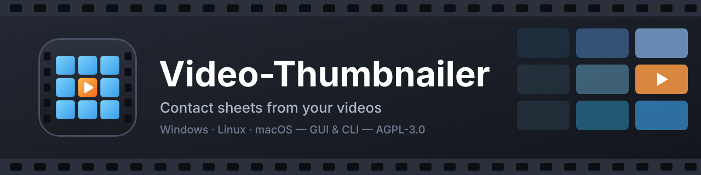
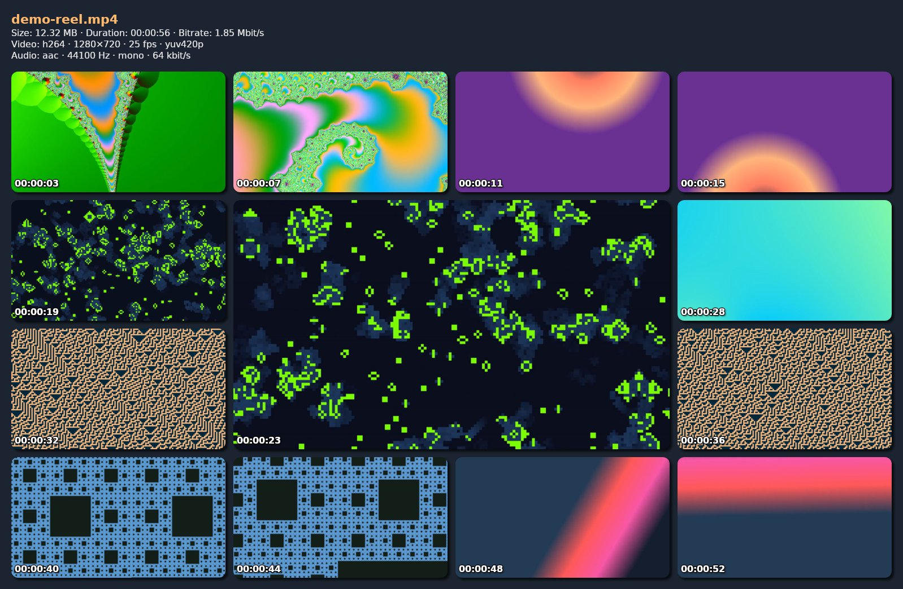
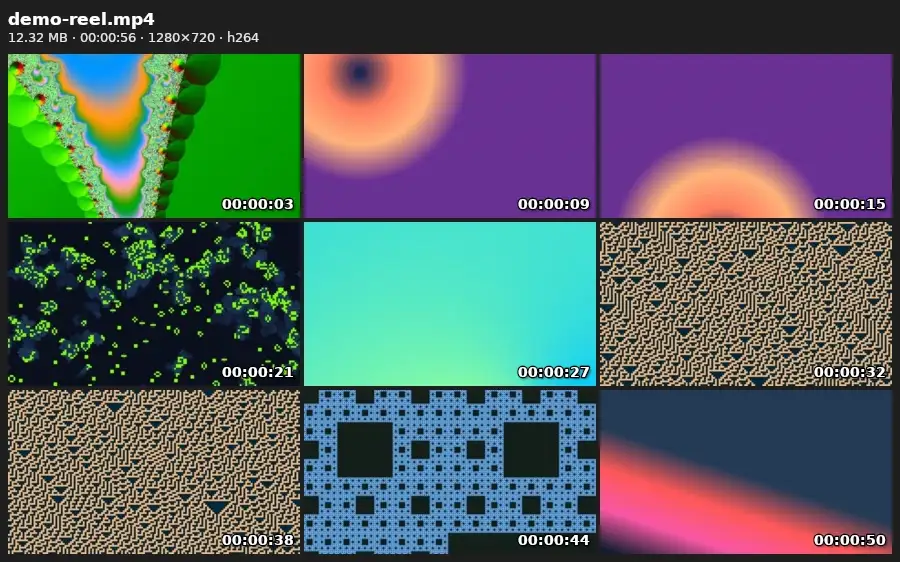
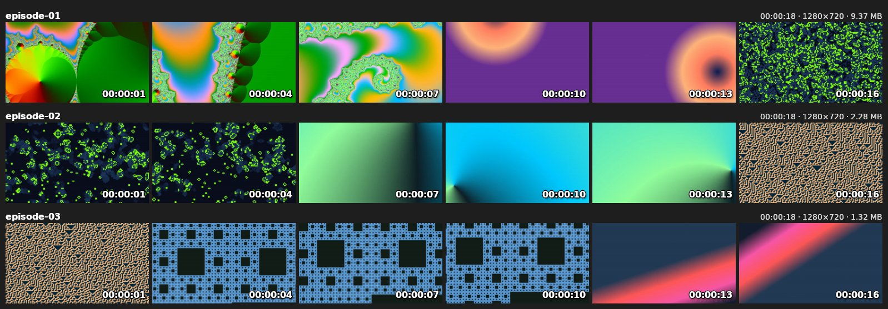
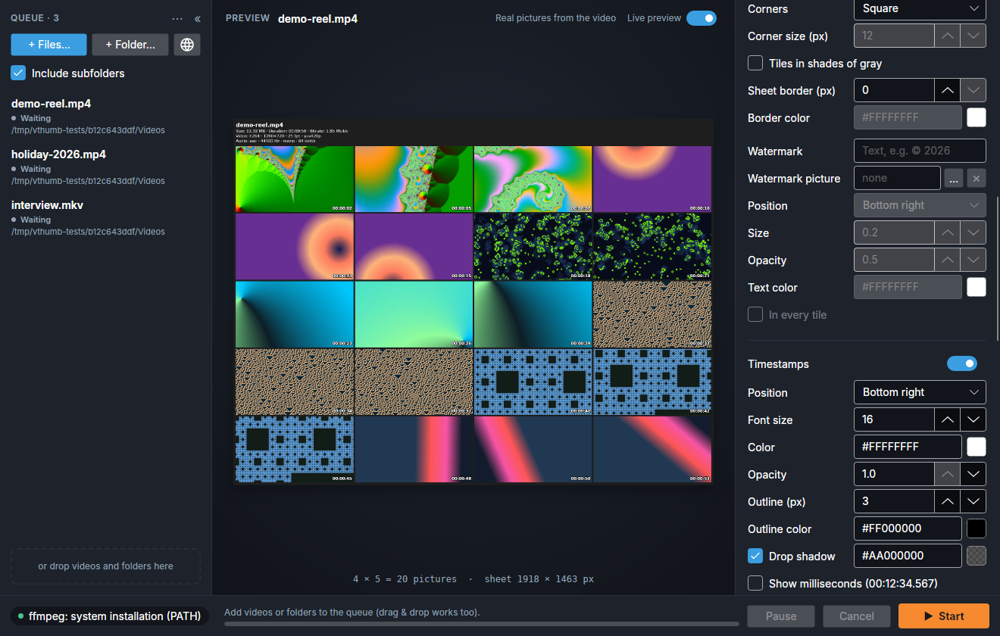
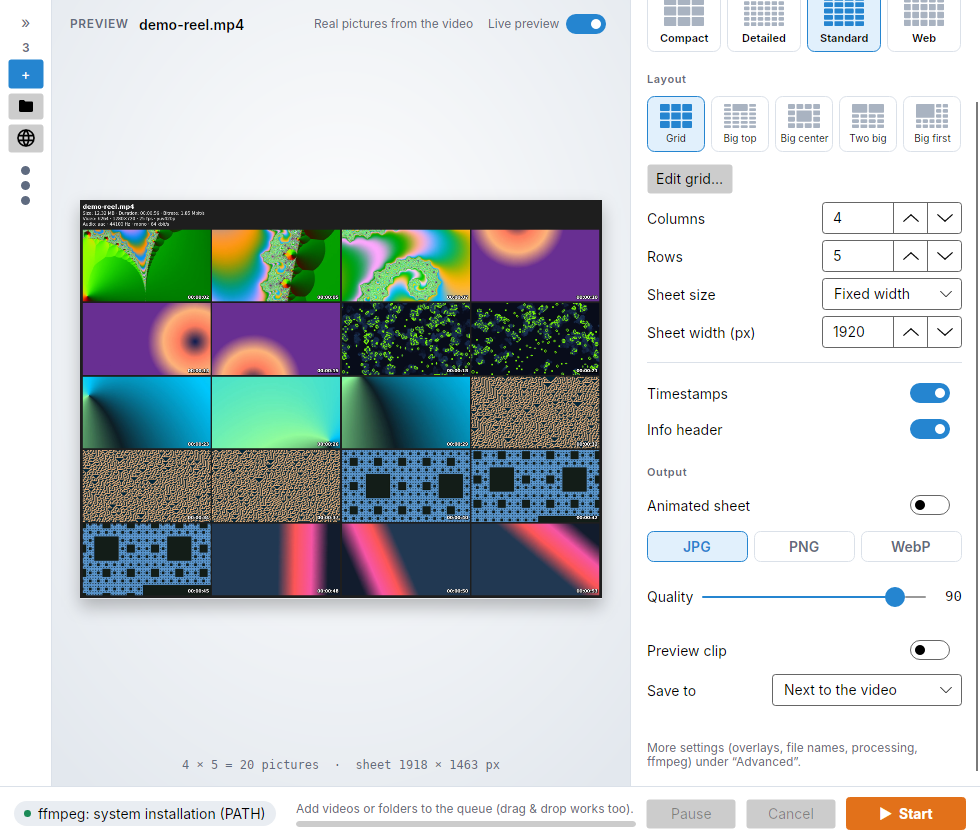
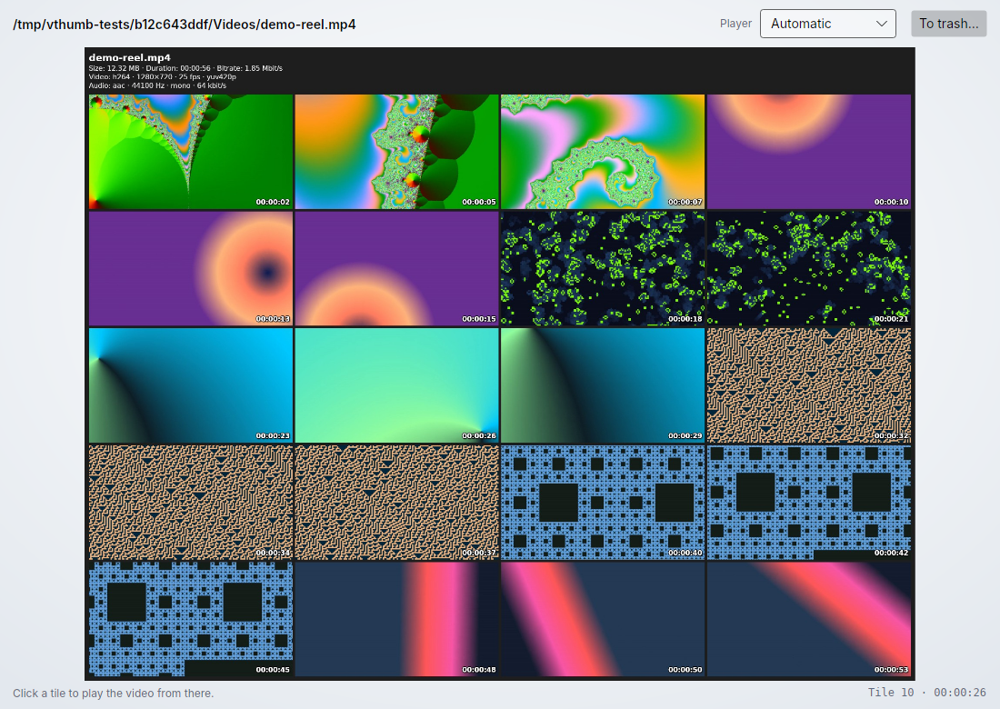
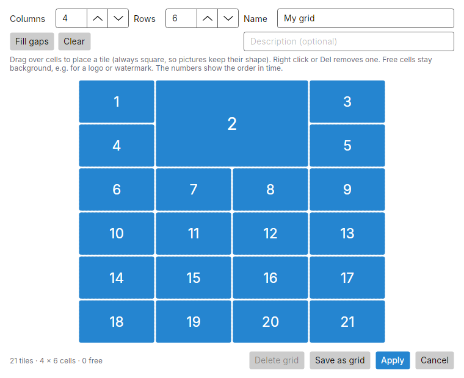

<p align="center"></p>

<p align="center">
  <a href="https://github.com/vulture20/Video-Thumbnailer/releases/latest"></a>
  <a href="https://github.com/vulture20/Video-Thumbnailer/releases"></a>
  
  <a href="LICENSE"></a>
</p>

# Video-Thumbnailer

**Kontaktbögen (Thumbnail-Sheets) aus Videos – schnell, schön und frei.** Ein Ordner voller Filme, Serien oder Aufnahmen rein, ein Übersichtsbild pro Video raus: mit Videodaten im Kopf, Zeitstempel in jeder Kachel und auf Wunsch animiert, als Trailer-Clip oder als Übersicht einer ganzen Staffel. Mit grafischer Oberfläche und vollwertiger Kommandozeile für **Windows, Linux und macOS**.

*Free, cross-platform video contact sheet generator with GUI and command line. The program speaks English and German; this page is in German.*

<p align="center"></p>

**Inhalt:** [Highlights](#highlights) · [Beispiele](#beispiele) · [Oberfläche](#oberfläche) · [Installation](#installation) · [Schnellstart](#schnellstart) · [Kommandozeile](#kommandozeile) · [Tastenkürzel](#tastenkürzel) · [Weitere Details](#weitere-details) · [ffmpeg](#ffmpeg) · [Selbst bauen](#selbst-bauen) · [Lizenz](#lizenz)

## Highlights

- 🎞️ **Jedes Format, das ffmpeg kennt** – MP4, MKV, AVI, MOV, WebM, WMV, TS …, auch 10 Bit/HDR, AV1, gedrehte und anamorphe Videos, sogar **direkt vom Webserver** per URL, ohne Download.
- 👀 **Live-Vorschau mit echten Bildern** – jede Einstellung sieht man sofort so, wie sie im Ergebnis aussieht.
- 🧩 **Raster nach Wunsch** – Spalten × Zeilen, Spezial-Raster mit großen Kacheln, ein eigener Raster-Editor, Anpassung an die Bildschirmgröße.
- 🧠 **Gute Bilder statt Schwarzbilder** – Abblenden und Schnitte werden automatisch durch ein Bild kurz davor oder danach ersetzt; Zeitpunkte lassen sich auch von Hand wählen.
- 🎨 **Gestaltung** – Info-Kopf mit frei wählbaren Videodaten, Zeitstempel, Farben, Hintergrundbild, Rahmen, Schatten, runde Ecken, Graustufen, Wasserzeichen.
- 🎬 **Bewegte Sheets und Trailer** – jede Kachel spielt einen Ausschnitt (MP4, WebM, GIF, WebP …), oder ein kurzer Vorschau-Clip aus mehreren Stellen.
- 📚 **Viele Videos auf einmal** – Warteschlange mit Pause, paralleler Verarbeitung auf allen Kernen, Pack-Bild einer ganzen Staffel, Video-Infos als CSV/XML.
- ▶️ **Viewer** – Klick auf eine Kachel startet das Video genau an dieser Stelle in mpv, VLC, MPC-HC oder PotPlayer.
- 🔒 **Sauber** – ffmpeg wird auf Wunsch geladen und per SHA-256 geprüft, Presets sind offene JSON-Dateien, portabler Modus für den USB-Stick.

## Beispiele

Alle Bilder auf dieser Seite sind mit dem Programm selbst entstanden (aus einem Demo-Video aus ffmpeg-Testmustern, siehe [Selbst bauen](#selbst-bauen)).

<table>
<tr>
<td width="50%"></td>
<td width="50%"></td>
</tr>
<tr>
<td><b>Spezial-Raster und Effekte</b><br><code>vthumb --layout big-center --corners rounded --tile-shadow --gap 14 --background "#1B2430" film.mkv</code></td>
<td><b>Animiertes Sheet</b> – jede Kachel spielt 2 Sekunden ab<br><code>vthumb -p Compact -a webp --clip-seconds 2 film.mkv</code></td>
</tr>
<tr>
<td colspan="2"></td>
</tr>
<tr>
<td colspan="2"><b>Pack-Bild</b> – eine Zeile je Video, z. B. für eine ganze Staffel<br><code>vthumb pack --tiles 6 -o staffel.jpg ~/Serien/Staffel1</code></td>
</tr>
</table>

## Oberfläche


<table>
<tr>
<td width="50%"></td>
<td width="50%"></td>
</tr>
<tr>
<td>Modus „Erweitert“ in dunkler Darstellung: alle Einstellungen, Farbfelder mit Farbwähler</td>
<td>Schmales Fenster: die Warteschlange klappt zu einer Leiste ein</td>
</tr>
<tr>
<td></td>
<td></td>
</tr>
<tr>
<td>Viewer: Klick auf eine Kachel spielt das Video ab dieser Stelle</td>
<td>Raster-Editor: eigene Anordnungen mit großen und kleinen Kacheln</td>
</tr>
</table>

Die Oberfläche gibt es auf Deutsch und Englisch (folgt der Systemsprache, im Zahnrad-Menü umschaltbar), hell, dunkel oder wie das System.

## Installation

Fertige Programme gibt es unter **[Releases](https://github.com/vulture20/Video-Thumbnailer/releases/latest)**. Es muss kein .NET installiert sein; ffmpeg lädt das Programm beim ersten Start nach Rückfrage selbst (oder nimmt ein vorhandenes).

<details open>
<summary><b>Windows</b> (x64 oder arm64)</summary>

1. `Video-Thumbnailer-…-win-x64-setup.exe` (bzw. `win-arm64`) herunterladen und starten. Es braucht keine Administratorrechte; der Installer legt einen Startmenü-Eintrag an und verknüpft auf Wunsch `.vtpreset`, `.vtsheet` und `.vtgrid`.
2. Der Installer ist nicht signiert: Warnt SmartScreen, auf „Weitere Informationen“ → „Trotzdem ausführen“ klicken.
3. Die Kommandozeile `vthumb.exe` liegt im Installationsordner.
</details>

<details open>
<summary><b>Linux</b> (x64 oder arm64)</summary>

```bash
chmod +x Video-Thumbnailer-*-linux-x64.AppImage
./Video-Thumbnailer-*-linux-x64.AppImage             # Oberfläche
./Video-Thumbnailer-*-linux-x64.AppImage vthumb --help  # Kommandozeile
```

Für Startmenü und Dateizuordnung das AppImage einbinden (z. B. mit AppImageLauncher) oder die ZIP-Fassung nach [packaging/linux/README.md](packaging/linux/README.md) einrichten.
</details>

<details open>
<summary><b>macOS</b> (Apple Silicon oder Intel)</summary>

1. `…-osx-arm64.dmg` (Apple Silicon) bzw. `…-osx-x64.dmg` (Intel) öffnen und die App nach „Programme“ ziehen.
2. Die App ist nicht notarisiert: beim ersten Start Rechtsklick → „Öffnen“ und bestätigen.
3. Die Kommandozeile liegt in `Video-Thumbnailer.app/Contents/MacOS/vthumb`, z. B. `ln -s /Applications/Video-Thumbnailer.app/Contents/MacOS/vthumb /usr/local/bin/vthumb`.
</details>

<details>
<summary><b>Portabel</b> (alle Systeme, ZIP)</summary>

`…-<system>.zip` enthält `VideoThumbnailer` (Oberfläche) und `vthumb` (Kommandozeile) als Einzeldateien, dazu `LICENSE`, `README.md` und `licenses/`. Liegt eine leere Datei `portable.txt` neben der Programmdatei, werden Einstellungen, Presets und ffmpeg im Ordner `data` daneben gespeichert – ideal für einen USB-Stick. Dasselbe erreicht die Umgebungsvariable `VIDEO_THUMBNAILER_HOME=<Ordner>`.
</details>

Die Prüfsummen aller Dateien stehen in `checksums.sha256` im Release. Einstellungen und Presets liegen sonst unter `%APPDATA%\VideoThumbnailer` (Windows), `~/.config/video-thumbnailer` (Linux) bzw. `~/Library/Application Support/VideoThumbnailer` (macOS).

## Schnellstart

**Oberfläche:** Videos oder Ordner ins Fenster ziehen (oder <kbd>Strg</kbd>+<kbd>O</kbd>), rechts ein Preset wählen und in der Vorschau prüfen, dann <kbd>Strg</kbd>+<kbd>Eingabe</kbd>. Die Sheets landen standardmäßig neben den Videos.

**Kommandozeile:**

```bash
vthumb film.mkv                       # ein Sheet neben das Video: film.jpg
vthumb -p Compact -o ~/Sheets ~/Videos  # alle Videos eines Ordners (rekursiv), Sheets nach ~/Sheets
vthumb --help                         # alle Optionen
```

## Kommandozeile

```text
vthumb [Optionen] <Datei|Ordner|URL>...
vthumb pack [Optionen] <Datei|Ordner>... -o <bild.jpg|png|webp>
vthumb presets list|show|import|export|delete
vthumb ffmpeg status|check|install|update|uninstall
```

Ohne `--preset` gelten die zuletzt in der Oberfläche benutzten Einstellungen (sonst „Standard“). **Jede Einstellung eines Presets lässt sich per Option ändern**; Optionen werden in der angegebenen Reihenfolge auf das Preset angewendet. Werte gehen auch als `--option=wert`. Farben als `#RRGGBB` oder `#AARRGGBB` (AA = Deckkraft), Deckkraft und Größen als `0–1` oder in Prozent.

### Beispiele

```bash
# Alle Videos eines Ordners (rekursiv), Sheets neben die Videos
vthumb ~/Videos

# Preset "Compact", 6 Spalten, WebP, alles in einen Ordner mit gleicher Unterordnerstruktur
vthumb -p Compact --columns 6 -f webp -o ~/Sheets --keep-structure ~/Videos

# Nur anzeigen, was passieren würde
vthumb --dry-run ~/Videos

# Animiertes Sheet: jede Kachel spielt 3 Sekunden ab, als MP4 (oder h265, webm, ogv, gif, webp, apng)
vthumb -a mp4 --clip-seconds 3 --fps 10 film.mkv     # -> film.sheet.mp4

# H.265-Video mit dem Ton der größten Kachel
vthumb -a h265 --audio --layout big-center film.mkv

# Zeitstempel gelb mit roter Kontur und Millisekunden, grüner Titel im Info-Kopf
vthumb --timestamp-color "#FFFF00" --outline-color "#FF0000" --milliseconds --title-color "#00FF00" film.mkv

# Video direkt vom Webserver (nur die nötigen Teile werden geladen), Sheet nach ~/Sheets
vthumb -o ~/Sheets "https://example.org/videos/vortrag.mp4"

# Zeitpunkte von Hand: Kachel 1 bei 1:00, Kachel 2 automatisch, Kachel 3 bei 5:30 (Ausschnitt 2 s lang)
vthumb --columns 3 --rows 1 --times "1:00,-,5:30+2" film.mkv

# Großes Bild in der Mitte, Sheet so groß, dass es ganz auf einen 2560×1440-Bildschirm passt
vthumb --layout big-center --fit-screen both --screen 2560x1440 film.mkv

# Hintergrundbild, abgedunkelt (Deckkraft 40 % über dunklem Hintergrund)
vthumb --background-image ~/Bilder/kino.jpg --background-opacity 40 film.mkv

# Abgerundete Kacheln mit hellem Rahmen und Schatten, Graustufen, Kommentar und Wasserzeichen
vthumb --gap 12 --corners rounded --tile-border 2 --tile-border-color "#E6E6E6" --tile-shadow --grayscale \
       --comment "Urlaub 2026" --watermark "© 2026" --watermark-opacity 0.4 film.mkv

# Logo als Wasserzeichen in jeder Kachel, oben links, ein Zehntel der Kachelbreite
vthumb --watermark-image logo.png --watermark-per-tile --watermark-pos top-left --watermark-size 0.1 film.mkv

# Vorschau-Clip: 12 Ausschnitte à 2,5 s mit Überblendung als „film.preview.mp4“ neben dem Sheet
vthumb --trailer mp4 film.mkv

# Nur einen GIF-Clip ohne Sheet: 8 Ausschnitte à 1,5 s, 480 px, harter Schnitt
vthumb --trailer gif --trailer-only --trailer-clips 8 --trailer-seconds 1.5 --trailer-size 480 --trailer-fade 0 film.mkv

# Daten aller Videos eines Ordners als Tabelle, ohne Sheets
vthumb --export-info videos.csv --info-only ~/Videos

# Sheet plus WebVTT-Vorschaubilder für einen Web-Player (film.thumbnails.vtt und film.thumbnails.jpg)
vthumb --webvtt --columns 10 --rows 10 film.mp4

# Sheet mit Begleitdatei für den Viewer (Klick auf eine Kachel spielt das Video dort ab)
vthumb --sidecar film.mkv

# Pack-Bild einer Staffel: 8 Bilder je Folge, 2400 px breit
vthumb pack ~/Serien/Staffel1 -o ~/staffel1.jpg --tiles 8 -w 2400

# Eigene Einstellungen als Preset speichern und weitergeben
vthumb --columns 5 --rows 6 --no-header --save-preset "5x6 ohne Kopf"
vthumb presets export "5x6 ohne Kopf" 5x6.vtpreset
```

### Alle Befehle und Optionen

<!-- Die Tabellen zwischen den Markierungen erzeugt ReadmeTests aus src/VideoThumbnailer.Cli/CliOptions.cs:
     VTHUMB_UPDATE_README=1 dotnet test --filter ReadmeTests -->
<!-- cli-options:start -->
| Aufruf | Zweck |
|---|---|
| `vthumb [Optionen] <Datei\|Ordner\|URL>…` | Sheets erstellen (Standard). |
| `vthumb pack [Optionen] <Datei\|Ordner>… -o <bild.jpg>` | Ein Übersichtsbild vieler Videos, eine Zeile je Video. `-c`/`--tiles` = Bilder je Video, `-w` = Breite; alle Sheet-Optionen gelten. |
| `vthumb presets list` | Alle Presets mit Kurzbeschreibung und Speicherort. |
| `vthumb presets show <Name>` | Ein Preset als JSON ausgeben. |
| `vthumb presets export <Name> <Datei>` | Preset als `.vtpreset` speichern (zum Weitergeben). |
| `vthumb presets import <Datei>` | Preset aus einer Datei übernehmen. |
| `vthumb presets delete <Name>` | Eigenes Preset löschen. |
| `vthumb ffmpeg status` | Zeigt, welches ffmpeg benutzt wird. |
| `vthumb ffmpeg check` | Sucht nach einem neueren hinterlegten ffmpeg-Build. |
| `vthumb ffmpeg install\|update [--force] [--latest]` | ffmpeg herunterladen bzw. aktualisieren (`--latest`: neuester Build statt des hinterlegten). |
| `vthumb ffmpeg uninstall` | Heruntergeladenes ffmpeg entfernen. |
| `vthumb --help \| --version` | Hilfe bzw. Version anzeigen. |

#### Eingabe und Ablauf

| Option | Wert | Bedeutung | Beispiel |
|---|---|---|---|
| `-r`<br>`--recursive`<br>`--no-recursive` |  | Unterordner mit durchsuchen (Standard: an) bzw. nur die angegebenen Ordner. | `vthumb --no-recursive ~/Videos` |
| `-n`<br>`--dry-run` |  | Nur auflisten, welche Videos gefunden werden und wohin die Sheets kämen; nichts erstellen. | `vthumb -n ~/Videos` |
| `-j`<br>`--jobs` | `<n>` | Höchstens so viele ffmpeg-Prozesse gleichzeitig (Standard: Anzahl der CPU-Kerne). | `vthumb -j 4 ~/Videos` |
| `--videos` | `<n>` | Höchstens so viele Videos gleichzeitig bearbeiten. | `vthumb --videos 2 ~/Videos` |
| `--ffmpeg` | `<Ordner>` | ffmpeg und ffprobe aus diesem Ordner verwenden. | `vthumb --ffmpeg /opt/ffmpeg/bin film.mkv` |
| `-y`<br>`--yes` |  | Fehlt ffmpeg, ohne Nachfrage herunterladen (für Skripte). | `vthumb -y film.mkv` |
| `--quiet` |  | Nur Fehler und die Zusammenfassung ausgeben. | `vthumb --quiet ~/Videos` |
| `--lang` | `de\|en\|auto` | Sprache von Hilfe und Meldungen (auch per Umgebungsvariable `VTHUMB_LANG`). | `vthumb --lang en ~/Videos` |
| `--sheet-lang` | `de\|en\|auto` | Sprache der Texte im Sheet (z. B. „Größe:“/„Size:“, Dezimalkomma). | `vthumb --sheet-lang en film.mkv` |

#### Preset und Raster

| Option | Wert | Bedeutung | Beispiel |
|---|---|---|---|
| `-p`<br>`--preset` | `<Name\|Datei>` | Preset nach Name oder als `.vtpreset`-Datei. Ohne Angabe gelten die zuletzt in der Oberfläche benutzten Einstellungen. | `vthumb -p Compact film.mkv` |
| `--save-preset` | `<Name>` | Die Einstellungen dieses Aufrufs als Preset speichern. | `vthumb -c 5 --rows 6 --save-preset "5x6"` |
| `--description` | `<Text>` | Beschreibung für das mit `--save-preset` gespeicherte Preset. | `vthumb -c 5 --save-preset Breit --description "5 Spalten"` |
| `-c`<br>`--columns` | `<n>` | Kacheln pro Zeile. | `vthumb -c 6 film.mkv` |
| `--rows` | `<n>` | Anzahl der Zeilen. | `vthumb --rows 8 film.mkv` |
| `-w`<br>`--width` | `<px>` | Gesamtbreite des Sheets; die Kachelhöhe ergibt sich aus dem Seitenverhältnis. | `vthumb -w 2560 film.mkv` |
| `--tile-width` | `<px>` | Feste Breite jeder Kachel (statt `--width`). | `vthumb --tile-width 320 film.mkv` |
| `--layout` | `<grid\|Name\|Datei>` | Spezial-Raster: `big-top`, `big-center`, `two-big`, `big-first`, ein eigenes Raster aus dem Editor oder eine `.vtgrid`-Datei; `grid` = einfaches Raster. | `vthumb --layout big-center film.mkv` |
| `--fit-screen` | `off\|width\|both` | Sheet so breit wie der Bildschirm (`width`) oder so groß, dass es ganz darauf passt (`both`). | `vthumb --fit-screen both film.mkv` |
| `--screen` | `<BxH>` | Bildschirmgröße für `--fit-screen` (Standard: der Bildschirm, auf dem die Oberfläche zuletzt war). | `vthumb --fit-screen both --screen 2560x1440 film.mkv` |
| `--gap` | `<px>` | Abstand zwischen den Kacheln. | `vthumb --gap 12 film.mkv` |
| `--margin` | `<px>` | Rand um das ganze Sheet. | `vthumb --margin 24 film.mkv` |
| `--order` | `row\|column\|random` | Reihenfolge der Kacheln: zeilenweise, spaltenweise oder zufällig. | `vthumb --order column film.mkv` |
| `--portrait-swap`<br>`--no-portrait-swap` |  | Bei Hochkant-Videos Spalten und Zeilen tauschen (Standard) bzw. beibehalten. | `vthumb --no-portrait-swap handy.mp4` |

#### Aufnahmezeitpunkte

| Option | Wert | Bedeutung | Beispiel |
|---|---|---|---|
| `--skip-start` | `<%>` | Diesen Anteil am Anfang des Videos auslassen (Vorspann). | `vthumb --skip-start 5 film.mkv` |
| `--skip-end` | `<%>` | Diesen Anteil am Ende auslassen (Abspann). | `vthumb --skip-end 8 film.mkv` |
| `--times` | `<Liste>` | Zeitpunkte von Hand, je Kachel in Zeitfolge: Sekunden, `mm:ss` oder `hh:mm:ss`; `-` = automatisch, `+s` = Länge des Ausschnitts bei animierten Sheets. | `vthumb -c 3 --rows 1 --times "1:00,-,5:30+2" film.mkv` |
| `--skip-black`<br>`--no-skip-black` |  | Schwarze oder einfarbige Bilder durch ein gutes Bild kurz davor oder danach ersetzen (Standard: an). | `vthumb --no-skip-black film.mkv` |
| `--black-search` | `<s>` | So viele Sekunden vor und nach dem Zeitpunkt nach einem guten Bild suchen (Standard 2). | `vthumb --black-search 5 film.mkv` |

#### Hintergrund, Kacheln und Rahmen

| Option | Wert | Bedeutung | Beispiel |
|---|---|---|---|
| `--background` | `<Farbe>` | Hintergrundfarbe als `#RRGGBB` oder `#AARRGGBB`. | `vthumb --background "#101820" film.mkv` |
| `--background-image` | `<Datei\|none>` | Bild hinter den Kacheln. | `vthumb --background-image kino.jpg film.mkv` |
| `--background-mode` | `fill\|stretch\|tile\|center` | Hintergrundbild füllen, strecken, kacheln oder zentrieren (Standard `fill`). | `vthumb --background-mode tile film.mkv` |
| `--background-opacity` | `<0–1 oder %>` | Wie stark das Bild über der Hintergrundfarbe liegt (Standard 0,5). | `vthumb --background-opacity 40 film.mkv` |
| `--font` | `<Schriftfamilie>` | Schrift für Info-Kopf und Zeitstempel. | `vthumb --font "DejaVu Sans" film.mkv` |
| `--tile-border`<br>`--no-tile-border` | `<px>` | Linie innen am Rand jeder Kachel bzw. keine. | `vthumb --tile-border 2 film.mkv` |
| `--tile-border-color` | `<Farbe>` | Farbe der Kachel-Linie. | `vthumb --tile-border 2 --tile-border-color "#E6E6E6" film.mkv` |
| `--tile-shadow`<br>`--no-tile-shadow` |  | Schlagschatten hinter jeder Kachel (fällt in den Abstand, also `--gap` setzen). | `vthumb --gap 12 --tile-shadow film.mkv` |
| `--tile-shadow-color` | `<Farbe>` | Farbe des Schattens (schaltet ihn ein). | `vthumb --tile-shadow-color "#80000000" film.mkv` |
| `--tile-shadow-offset` | `<px>` | Versatz des Schattens nach rechts unten (Standard 4). | `vthumb --tile-shadow-offset 6 film.mkv` |
| `--tile-shadow-blur` | `<px>` | Weichheit des Schattens (Standard 4). | `vthumb --tile-shadow-blur 8 film.mkv` |
| `--grayscale`<br>`--no-grayscale` |  | Kacheln in Graustufen. | `vthumb --grayscale film.mkv` |
| `--corners` | `square\|rounded\|cut` | Ecken der Kacheln: eckig, abgerundet oder abgeschnitten. | `vthumb --corners rounded film.mkv` |
| `--corner-radius` | `<px>` | Radius der runden bzw. Größe der abgeschnittenen Ecken (Standard 12). | `vthumb --corners rounded --corner-radius 20 film.mkv` |
| `--sheet-border`<br>`--no-sheet-border` | `<px>` | Linie um das ganze Sheet (liegt im Rand) bzw. keine. | `vthumb --margin 16 --sheet-border 3 film.mkv` |
| `--sheet-border-color` | `<Farbe>` | Farbe der Linie um das Sheet. | `vthumb --sheet-border 3 --sheet-border-color "#FFD700" film.mkv` |

#### Zeitstempel

| Option | Wert | Bedeutung | Beispiel |
|---|---|---|---|
| `--timestamps`<br>`--no-timestamps` |  | Zeitstempel in jeder Kachel anzeigen bzw. weglassen. | `vthumb --no-timestamps film.mkv` |
| `--timestamp-pos` | `top-left\|top-right\|bottom-left\|bottom-right\|center` | Position des Zeitstempels in der Kachel. | `vthumb --timestamp-pos top-left film.mkv` |
| `--timestamp-size` | `<pt>` | Schriftgröße des Zeitstempels. | `vthumb --timestamp-size 18 film.mkv` |
| `--timestamp-bold`<br>`--no-timestamp-bold` |  | Zeitstempel fett bzw. normal. | `vthumb --no-timestamp-bold film.mkv` |
| `--timestamp-color` | `<Farbe>` | Textfarbe des Zeitstempels. | `vthumb --timestamp-color "#FFFF00" film.mkv` |
| `--timestamp-opacity` | `<0–1 oder %>` | Deckkraft des Zeitstempels. | `vthumb --timestamp-opacity 70 film.mkv` |
| `--timestamp-padding` | `<px>` | Abstand des Zeitstempels vom Kachelrand. | `vthumb --timestamp-padding 10 film.mkv` |
| `--outline-color` | `<Farbe>` | Farbe der Kontur um die Ziffern. | `vthumb --outline-color "#FF0000" film.mkv` |
| `--outline-width`<br>`--no-outline` | `<px>` | Breite der Kontur bzw. keine Kontur. | `vthumb --outline-width 3 film.mkv` |
| `--shadow`<br>`--no-shadow` |  | Schatten unter dem Zeitstempel. | `vthumb --no-shadow film.mkv` |
| `--shadow-color` | `<Farbe>` | Farbe des Zeitstempel-Schattens (schaltet ihn ein). | `vthumb --shadow-color "#000000" film.mkv` |
| `--shadow-offset` | `<px>` | Versatz des Zeitstempel-Schattens. | `vthumb --shadow-offset 2 film.mkv` |
| `--milliseconds`<br>`--no-milliseconds` |  | Zeit mit Millisekunden, z. B. `00:12:34.567`. | `vthumb --milliseconds film.mkv` |

#### Info-Kopf und Kommentar

| Option | Wert | Bedeutung | Beispiel |
|---|---|---|---|
| `--header`<br>`--no-header` |  | Info-Kopf mit Videodaten über (oder unter) den Kacheln anzeigen bzw. weglassen. | `vthumb --no-header film.mkv` |
| `--header-pos` | `top-left\|top-right\|bottom-left\|bottom-right` | Lage des Info-Kopfs. | `vthumb --header-pos bottom-left film.mkv` |
| `--header-template` | `<Vorlage>` | Zeilen des Info-Kopfs mit Platzhaltern (siehe unten), `\n` für eine neue Zeile. | `vthumb --header-template "{filename}\n{size:GB} · {duration} · {resolution}" film.mkv` |
| `--title-size` | `<pt>` | Schriftgröße der Titelzeile. | `vthumb --title-size 28 film.mkv` |
| `--header-size` | `<pt>` | Schriftgröße der übrigen Zeilen. | `vthumb --header-size 16 film.mkv` |
| `--title-color` | `<Farbe>` | Farbe der Titelzeile. | `vthumb --title-color "#00FF00" film.mkv` |
| `--header-color` | `<Farbe>` | Farbe der übrigen Zeilen. | `vthumb --header-color "#CCCCCC" film.mkv` |
| `--line-spacing` | `<Faktor>` | Zeilenabstand im Info-Kopf (Standard 1,25). | `vthumb --line-spacing 1.5 film.mkv` |
| `--comment`<br>`--no-comment` | `<Text>` | Eigener Text unter dem Info-Kopf (oder an der Stelle von `{comment}`), `\n` für weitere Zeilen. | `vthumb --comment "Urlaub 2026" film.mkv` |

#### Wasserzeichen

| Option | Wert | Bedeutung | Beispiel |
|---|---|---|---|
| `--watermark` | `<Text>` | Text als Wasserzeichen. | `vthumb --watermark "© 2026" film.mkv` |
| `--watermark-image` | `<Datei\|none>` | Bild (z. B. PNG mit Transparenz) als Wasserzeichen; hat Vorrang vor dem Text. | `vthumb --watermark-image logo.png film.mkv` |
| `--no-watermark` |  | Kein Wasserzeichen (auch wenn das Preset eines hat). | `vthumb -p Web --no-watermark film.mkv` |
| `--watermark-pos` | `top-left\|top-right\|bottom-left\|bottom-right\|center\|tiled` | Ecke, Mitte oder über die ganze Fläche wiederholt. | `vthumb --watermark "Demo" --watermark-pos tiled film.mkv` |
| `--watermark-size` | `<0–1 oder %>` | Breite im Verhältnis zum Sheet bzw. zur Kachel (Standard 0,2). | `vthumb --watermark "Demo" --watermark-size 0.1 film.mkv` |
| `--watermark-opacity` | `<0–1 oder %>` | Deckkraft (Standard 0,5). | `vthumb --watermark "Demo" --watermark-opacity 0.4 film.mkv` |
| `--watermark-color` | `<Farbe>` | Farbe des Text-Wasserzeichens. | `vthumb --watermark "Demo" --watermark-color "#FFFFFF" film.mkv` |
| `--watermark-per-tile`<br>`--watermark-sheet` |  | Wasserzeichen in jeder Kachel bzw. einmal über dem ganzen Sheet. | `vthumb --watermark "Demo" --watermark-per-tile film.mkv` |

#### Ausgabe

| Option | Wert | Bedeutung | Beispiel |
|---|---|---|---|
| `-f`<br>`--format` | `jpg\|png\|webp` | Bildformat des Sheets. | `vthumb -f webp film.mkv` |
| `-q`<br>`--quality` | `<1–100>` | Qualität für JPG und WebP. | `vthumb -q 80 film.mkv` |
| `-o`<br>`--output` | `<Ordner>` | Alle Sheets in diesen Ordner schreiben. | `vthumb -o ~/Sheets ~/Videos` |
| `--keep-structure`<br>`--no-keep-structure` |  | Mit `-o`: die Ordnerstruktur der Eingabe nachbilden. | `vthumb -o ~/Sheets --keep-structure ~/Videos` |
| `--next-to-video` |  | Sheet neben das jeweilige Video schreiben (Standard). | `vthumb --next-to-video ~/Videos` |
| `--subfolder` | `<Name>` | Sheet in einen Unterordner neben dem Video schreiben. | `vthumb --subfolder sheets ~/Videos` |
| `--pattern` | `<Muster>` | Dateiname mit `{name}` `{ext}` `{preset}` `{cols}` `{rows}` `{date}` `{time}`. | `vthumb --pattern "{name}_{cols}x{rows}" film.mkv` |
| `--overwrite` | `skip\|overwrite\|rename` | Was mit vorhandenen Sheets passiert. | `vthumb --overwrite rename film.mkv` |
| `--frames`<br>`--no-frames` |  | Zusätzlich jede Aufnahme als Einzelbild speichern. | `vthumb --frames film.mkv` |
| `--frames-folder` | `<Muster>` | Ordner der Einzelbilder, relativ zum Sheet (Standard `{name}_frames`). | `vthumb --frames-folder "{name}-bilder" film.mkv` |

#### Animiertes Sheet

| Option | Wert | Bedeutung | Beispiel |
|---|---|---|---|
| `-a`<br>`--animated` | `mp4\|h265\|webm\|ogv\|gif\|webp\|apng` | Animiertes Sheet: jede Kachel spielt einen kurzen Ausschnitt ab ihrem Zeitpunkt. | `vthumb -a webp film.mkv` |
| `--still` |  | Standbild, auch wenn das Preset animiert ist. | `vthumb -p MeinAnimiertes --still film.mkv` |
| `--clip-seconds` | `<s>` | Länge jedes Ausschnitts (Standard 3). | `vthumb -a mp4 --clip-seconds 5 film.mkv` |
| `--fps` | `<n>` | Bilder pro Sekunde der Animation (Standard 10). | `vthumb -a gif --fps 8 film.mkv` |
| `--audio`<br>`--no-audio` |  | Ton der größten (sonst ersten) Kachel mitnehmen; nur bei mp4, h265, webm, ogv. | `vthumb -a h265 --audio --layout big-center film.mkv` |

#### Vorschau-Clip (Trailer)

| Option | Wert | Bedeutung | Beispiel |
|---|---|---|---|
| `--trailer`<br>`--no-trailer` | `mp4\|h265\|webm\|ogv\|gif\|webp\|apng` | Zusätzlich einen Clip aus kurzen Ausschnitten schreiben (`<Name>.preview.<Endung>`). | `vthumb --trailer mp4 film.mkv` |
| `--trailer-only`<br>`--with-sheet` |  | Nur den Clip, kein Sheet bzw. beides. | `vthumb --trailer gif --trailer-only film.mkv` |
| `--trailer-clips` | `<n>` | Anzahl der Ausschnitte (Standard 12). | `vthumb --trailer mp4 --trailer-clips 8 film.mkv` |
| `--trailer-seconds` | `<s>` | Länge jedes Ausschnitts (Standard 2,5; der Clip bleibt unter 2 Minuten). | `vthumb --trailer mp4 --trailer-seconds 1.5 film.mkv` |
| `--trailer-fade` | `<s>` | Überblendung zwischen den Ausschnitten, 0 = harter Schnitt (Standard 0,5). | `vthumb --trailer mp4 --trailer-fade 0 film.mkv` |
| `--trailer-size` | `<px>` | Längere Bildseite (Standard 640). | `vthumb --trailer gif --trailer-size 480 film.mkv` |
| `--trailer-fps` | `<n>` | Bilder pro Sekunde (Standard 24). | `vthumb --trailer webm --trailer-fps 30 film.mkv` |
| `--trailer-timestamps`<br>`--no-trailer-timestamps` |  | Zeit jedes Ausschnitts in der Ecke (Standard: an). | `vthumb --trailer mp4 --no-trailer-timestamps film.mkv` |
| `--trailer-audio`<br>`--no-trailer-audio` |  | Ton der Ausschnitte mitnehmen (mp4, h265, webm, ogv). | `vthumb --trailer mp4 --trailer-audio film.mkv` |

#### Begleitdateien und Video-Infos

| Option | Wert | Bedeutung | Beispiel |
|---|---|---|---|
| `--sidecar`<br>`--no-sidecar` |  | Begleitdatei `<Name>.vtsheet` mit Zeitpunkt und Rechteck jeder Kachel, für den Viewer. | `vthumb --sidecar film.mkv` |
| `--webvtt`<br>`--no-webvtt` |  | WebVTT-Vorschaubilder für Web-Player: `<Name>.thumbnails.vtt` und Sprite `<Name>.thumbnails.jpg`. | `vthumb --webvtt -c 10 --rows 10 film.mp4` |
| `--webvtt-width` | `<px>` | Breite eines Bildes im Sprite (Standard 160). | `vthumb --webvtt-width 240 film.mp4` |
| `--export-info` | `<Datei.csv\|Datei.xml>` | Technische Daten aller Videos als CSV- oder XML-Tabelle (eine Zeile je Video). | `vthumb --export-info videos.csv ~/Videos` |
| `--info-only` |  | Mit `--export-info`: nur die Tabelle, keine Sheets. | `vthumb --export-info videos.xml --info-only ~/Videos` |
<!-- cli-options:end -->

**Sprache:** Ohne `--lang` gilt die in der Oberfläche gewählte Sprache, sonst die Systemsprache.
**Exit-Codes:** `0` ok · `1` einzelne Videos fehlgeschlagen · `2` Aufruffehler · `3` ffmpeg fehlt · `130` abgebrochen.

### Platzhalter

Im **Info-Kopf** (`--header-template`, in der Oberfläche unter „Erweitert“):

`{filename}` `{name}` `{ext}` `{folder}` `{path}` `{title}` `{container}` `{size}` `{size:B|KB|MB|GB|TB}` `{duration}` `{bitrate}`
`{width}` `{height}` `{resolution}` `{vcodec}` `{vprofile}` `{fps}` `{pixfmt}` `{hdr}` `{vbitrate}` `{rotation}`
`{audio}` `{acodec}` `{samplerate}` `{channels}` `{channellayout}` `{abitrate}` `{alang}` `{audiotracks}`
`{subtitles}` `{slang}` `{subtracks}` `{comment}`

Die erste Zeile wird fett und größer dargestellt. `{comment}` ist der eigene Kommentartext; steht er nicht in der Vorlage, kommt der Kommentar als letzte Zeile(n) dazu.

Im **Dateinamen** (`--pattern`): `{name}` `{ext}` `{preset}` `{cols}` `{rows}` `{date}` `{time}`

## Tastenkürzel

Die Kürzel stehen auch in den Tooltips der Knöpfe. Unter macOS gilt <kbd>⌘</kbd> statt <kbd>Strg</kbd>.

<!-- shortcuts:start -->
| Windows / Linux | macOS | Aktion |
|---|---|---|
| <kbd>Strg+O</kbd> | <kbd>⌘O</kbd> | Dateien hinzufügen |
| <kbd>Strg+Umschalt+O</kbd> | <kbd>⇧⌘O</kbd> | Ordner hinzufügen |
| <kbd>Strg+U</kbd> | <kbd>⌘U</kbd> | Webadresse (URL) hinzufügen |
| <kbd>Strg+Eingabe</kbd> oder <kbd>F5</kbd> | <kbd>⌘↩</kbd> oder <kbd>F5</kbd> | Starten |
| <kbd>Strg+P</kbd> | <kbd>⌘P</kbd> | Pause / Fortsetzen |
| <kbd>Esc</kbd> | <kbd>⎋</kbd> | Abbrechen (während eines Laufs) |
| <kbd>Strg+A</kbd> | <kbd>⌘A</kbd> | Alle Einträge der Warteschlange auswählen |
| <kbd>Entf</kbd> | <kbd>⌫</kbd> | Ausgewählte Einträge aus der Warteschlange entfernen |
| <kbd>Strg+R</kbd> | <kbd>⌘R</kbd> | Ausgewählte fertige Einträge erneut einreihen |
| <kbd>Strg+E</kbd> | <kbd>⌘E</kbd> | Zwischen „Einfach“ und „Erweitert“ umschalten |
| <kbd>Strg+L</kbd> | <kbd>⌘L</kbd> | Live-Vorschau ein/aus |
| <kbd>Strg+B</kbd> | <kbd>⌘B</kbd> | Warteschlange ein-/ausklappen |
| <kbd>Esc</kbd> | <kbd>⎋</kbd> | Viewer: schließen |
| <kbd>Entf</kbd> | <kbd>⌫</kbd> | Viewer: Video (auf Wunsch mit Sheet) in den Papierkorb verschieben |
| <kbd>Entf / Rücktaste</kbd> | <kbd>⌫</kbd> | Raster-Editor: Kachel unter dem Mauszeiger entfernen (ebenso Rechtsklick) |
<!-- shortcuts:end -->

Außerdem: Doppelklick auf einen erledigten Eintrag öffnet das Sheet im Viewer, Rechtsklick auf einen Eintrag zeigt seine Aktionen, und Videos, Ordner und Webadressen lassen sich ins Fenster ziehen.

## Weitere Details

<details>
<summary><b>Videos per URL</b></summary>

`http://` und `https://` werden direkt von ffmpeg gelesen. Schnell geht das, wenn der Server Range-Anfragen unterstützt (übliche Webserver und CDNs tun das); sonst muss ffmpeg bis zur Stelle lesen, und Formate mit Index am Dateiende (manche MP4) lassen sich dann gar nicht öffnen. Nach 30 s ohne Daten wird abgebrochen. Da es „neben dem Video“ nicht gibt, landen die Sheets im Ausgabeordner, ohne einen solchen in der Oberfläche im Bilder-Ordner des Benutzers und in der Kommandozeile im aktuellen Ordner. Name, Endung und `{folder}`/`{path}` stammen aus der Adresse; Benutzername, Passwort und Query-Parameter (oft Zugangsschlüssel) erscheinen nicht im Sheet. In der Oberfläche: Knopf mit Weltkugel (<kbd>Strg</kbd>+<kbd>U</kbd>) oder Adresse aus dem Browser ins Fenster ziehen.
</details>

<details>
<summary><b>Zeitpunkte von Hand</b></summary>

In der Oberfläche eine Kachel in der Vorschau anklicken und den Zeitpunkt per Schieberegler, Eingabe oder bildgenau wählen (bei animierten Sheets auch die Länge des Ausschnitts). `--times` nimmt eine Liste je Kachel in Zeitfolge (bei „zufällig“ also nicht nach Position): Sekunden, `mm:ss` oder `hh:mm:ss` (mit Nachkommastellen), `-` für automatisch, `+s` für die Länge des Ausschnitts bei animierten Sheets. Die Liste gilt für alle angegebenen Videos und gehört nicht zum Preset. Von Hand gewählte Zeitpunkte werden nie als „schwarz“ ersetzt. In der Oberfläche gelten sie für das Video in der Warteschlange und bleiben bis zum Schließen des Programms erhalten.
</details>

<details>
<summary><b>Spezial-Raster und Raster-Editor</b></summary>

Eingebaut sind `big-top` (großes Bild oben, 21 Bilder), `big-center` (großes Bild in der Mitte, 13), `two-big` (zwei große oben, 14) und `big-first` (erstes Bild groß oben links, 17). Eigene Vorlagen stehen im Preset unter `template` oder in einer eigenen JSON-Datei für `--layout`: ein Raster aus `columns` × `rows` Feldern im Seitenverhältnis des Videos und darauf die Kacheln mit linkem oberen Feld und Größe in Feldern (immer quadratisch, damit kein Bild verzerrt wird); Felder ohne Kachel bleiben frei. Die Zeitpunkte laufen nach dem linken oberen Feld jeder Kachel, zeilenweise oder spaltenweise.

```json
{ "name": "Breitbild", "columns": 3, "rows": 3,
  "tiles": [ { "x": 0, "y": 0, "size": 2 }, { "x": 2, "y": 0 }, { "x": 2, "y": 1 },
             { "x": 0, "y": 2 }, { "x": 1, "y": 2 }, { "x": 2, "y": 2 } ] }
```

„Raster bearbeiten…“ unter der Layout-Auswahl öffnet das aktuelle Raster (oder das einfache Raster) auf einem Feldraster im Seitenverhältnis des Videos. Ziehen über Felder legt eine quadratische Kachel an, Rechtsklick oder <kbd>Entf</kbd> entfernt eine, „Lücken füllen“ setzt kleine Kacheln in freie Felder; leere Felder bleiben Hintergrund, etwa für ein Logo. „Übernehmen“ verwendet das Raster nur in den aktuellen Einstellungen (und im Preset), „Als Raster speichern“ legt zusätzlich `<Name>.vtgrid` im Einstellungsordner (`grids`) ab. Gespeicherte Raster erscheinen neben den eingebauten, gelten auf der Kommandozeile mit `--layout <Name>` und lassen sich als Datei weitergeben (Doppelklick nimmt sie auf).
</details>

<details>
<summary><b>An Bildschirm anpassen</b></summary>

In der Oberfläche zählt der Bildschirm, auf dem das Fenster ist (nutzbare Fläche ohne Taskleiste, in physischen Pixeln). Die Kommandozeile nimmt `--screen BxH`, sonst den zuletzt von der Oberfläche gesehenen Bildschirm, sonst die feste Breite des Presets.
</details>

<details>
<summary><b>Hintergrund, Kachel-Effekte und Wasserzeichen</b></summary>

**Hintergrundbild und Wasserzeichen-Bild:** Relative Pfade in einer Preset-Datei gelten relativ zu deren Ordner; beim Export wird ein Bild im selben Ordner relativ eingetragen, sodass Preset und Bild zusammen weitergegeben werden können.

**Kachel-Effekte:** Der Rahmen wird innen an der Kachel gezeichnet, die Bildgröße ändert sich also nicht. Der Schatten fällt in den Abstand zwischen den Kacheln; ohne Abstand ist er kaum zu sehen (Faustregel: Abstand etwa so groß wie Versatz plus Weichheit, Standard je 4 px). Der Sheet-Rahmen liegt im Rand. Einzelbilder (`--frames`) bleiben unverändert.

**Wasserzeichen:** Ein Bild hat Vorrang vor dem Text. Die Größe ist die Breite des Wasserzeichens im Verhältnis zur Sheet-Breite (mit `--watermark-per-tile` zur Kachelbreite), höchstens so hoch wie die Fläche. Es liegt über dem Info-Kopf, in Kacheln unter dem Zeitstempel. Einzelbilder bekommen kein Wasserzeichen.
</details>

<details>
<summary><b>Animierte Sheets und Vorschau-Clip</b></summary>

**Formate:** MP4 (H.264) läuft überall; H.265 ist kleiner, spielt aber nicht jeder Browser ab. WebP und GIF eignen sich für Webseiten und Foren, APNG ist verlustfrei und entsprechend groß, OGV (Theora) gibt es für ältere freie Umgebungen. Mit `--audio` (bzw. „Mit Ton“) läuft der Ton der größten Kachel während ihres Ausschnitts, bei gleich großen Kacheln der der ersten; GIF, WebP und APNG können keinen Ton enthalten.

**Vorschau-Clip:** Die Ausschnitte sind gleichmäßig über das Video verteilt (Anfang/Ende überspringen und schwarze Bilder wie beim Sheet). Standard sind 12 Ausschnitte à 2,5 s mit 0,5 s Überblendung, 640 px an der längeren Seite und 24 Bilder/s, der Zeitstempel im Stil des Sheets. Wird der Clip länger als 2 Minuten, werden die Ausschnitte kürzer; ein kurzes Video bekommt nur so viele Ausschnitte, wie hineinpassen. Mit `--trailer-audio` läuft der Ton der Ausschnitte mit (überblendet wie das Bild). Der Clip heißt `<Name>.preview.<Endung>` und liegt neben dem Sheet; beim Ordner-Scan wird er wie `*.sheet.*` übersprungen.
</details>

<details>
<summary><b>Pack-Bild</b></summary>

Je Video eine Zeile mit Name (bzw. Titel), Dauer, Auflösung und Größe, darunter so viele Bilder, wie das Raster Spalten hat (`-c`/`--tiles`), so breit wie das Sheet (`-w`). Farben, Schrift, Zeitstempel, Abstände und übersprungener Anfang/Ende kommen aus den Einstellungen bzw. dem Preset. Hochkant-Videos stehen eingepasst in der 16:9-Fläche. Ist das Bild für das Format zu hoch (WebP 16383 px, JPEG 65000 px, PNG 32000 px), entstehen `pack-1`, `pack-2` …
</details>

<details>
<summary><b>Begleitdatei und Viewer</b></summary>

Mit `--sidecar` bzw. „Begleitdatei mit Kachel-Zeiten“ entsteht neben dem Sheet `<Name>.vtsheet`, ein offenes JSON mit Video, Sheet-Größe sowie Rechteck und Zeitpunkt jeder Kachel ([Format](docs/vtsheet.md)). Der Viewer öffnet sie per Doppelklick (Datei oder erledigter Eintrag der Warteschlange) oder über „⋯“ → „Sheet öffnen…“. Ein Klick auf eine Kachel startet das Video dort; der Player ist im Viewer wählbar: „Automatisch“ sucht mpv, VLC, MPC-HC/MPC-BE und PotPlayer, „Eigener Befehl“ nimmt eine Befehlszeile mit `{file}`, `{seconds}`, `{ms}` und `{time}`. Der Systemstandard kennt keinen Startzeitpunkt und öffnet das Video am Anfang. „In den Papierkorb…“ (<kbd>Entf</kbd>) verschiebt das Video nach Rückfrage in den Papierkorb, auf Wunsch mit Sheet und Begleitdateien; geht das nicht, bleibt alles, wo es ist. Zeitpunkte von Hand stehen ebenfalls in der Begleitdatei und kommen zurück, wenn das Video wieder in die Warteschlange kommt.
</details>

<details>
<summary><b>Video-Infos als CSV/XML und WebVTT</b></summary>

**Video-Infos:** Eine Datei je Lauf mit einer Zeile (CSV) bzw. einem `<video>`-Element (XML) je Video. Die Spalten heißen wie die Platzhalter des Info-Kopfs (`filename`, `size`, `duration`, `vcodec` …); Zahlen stehen ohne Einheit und mit Punkt (Größe in Bytes, Dauer in Sekunden, Bitraten in bit/s), damit Tabellenkalkulationen und Skripte sie in jeder Sprache lesen. Nicht lesbare Dateien stehen mit Grund in der Spalte `error`. CSV mit Komma (RFC 4180), UTF-8 mit BOM. In der Oberfläche: „⋯“ über der Warteschlange → „Video-Infos exportieren…“.

**WebVTT:** `<Name>.thumbnails.jpg` enthält die aufgenommenen Bilder (160 px breit, `--webvtt-width`) in einem Raster ohne Kopf, Zeitstempel und Effekte; `<Name>.thumbnails.vtt` ordnet jedem Zeitbereich ein Bild zu (`#xywh=`). Jedes Bild gilt bis zur Mitte zwischen ihm und dem nächsten. Für eine feine Zeitleiste ein Preset mit vielen Kacheln verwenden (z. B. 10 × 10).
</details>

<details>
<summary><b>Untertitel</b></summary>

Gezählt werden Untertitelspuren im Video und Dateien neben dem Video mit gleichem Namen: `Film.srt`, `Film.de.srt`, `Film.en.forced.ass`, `Film.eng.sdh.vtt`, `Film.sup`, `Film.idx` (mit `.sub`). Zwischen Name und Endung dürfen nur ein Sprachcode und `forced`, `sdh`, `hi`, `cc` stehen, sonst gehört die Datei zu einem anderen Video. `{subtitles}` ergibt z. B. „3: ger SRT, eng PGS erzwungen, de SRT extern“. Untertitel werden nicht ins Bild eingebrannt.
</details>

<details>
<summary><b>Presets und Preset-Dateien</b></summary>

Mitgeliefert sind die Basis-Presets „Compact“, „Detailed“, „Standard“ und „Web“; eigene Presets sind offene JSON-Dateien im Einstellungsordner. Exportierte Presets heißen `<Name>.vtpreset` (Inhalt JSON) und öffnen sich per Doppelklick: das Preset wird übernommen und gewählt. Läuft das Programm schon, bekommt das offene Fenster die Datei (ebenso Videos über „Öffnen mit“). Der Installer für Windows trägt die Endung ein (abwählbar), das DMG für macOS ebenso; unter Linux siehe [packaging/linux/README.md](packaging/linux/README.md). Ältere `*.vtpreset.json`-Dateien lassen sich weiter importieren und öffnen.
</details>

<details>
<summary><b>Warteschlange: erneut einreihen</b></summary>

Fertige Einträge der Warteschlange (erstellt, übersprungen, fehlgeschlagen oder abgebrochen) kommen per Rechtsklick → „Erneut einreihen“ oder <kbd>Strg</kbd>+<kbd>R</kbd> (für alle ausgewählten), über ↻ am Eintrag (erscheint beim Überfahren) oder über „⋯“ → „Alle erledigten erneut einreihen“ bzw. „Fehlgeschlagene erneut versuchen“ zurück auf „Wartet“. Sie bleiben an ihrer Stelle und laufen beim nächsten Start mit den aktuellen Einstellungen; von Hand gewählte Zeitpunkte bleiben. Das vorhandene Sheet wird ersetzt, auch wenn vorhandene Dateien sonst übersprungen werden; bei „Umbenennen“ entsteht eine neue Datei. Während eines Laufs geht das nicht.
</details>

## ffmpeg

ffmpeg wird nicht mitgeliefert. Fehlt es, bietet das Programm den Download an (Kommandozeile: `-y` bzw. `vthumb ffmpeg install`); ein vorhandenes ffmpeg wird automatisch gefunden. Reihenfolge der Suche: eigener Ordner (Einstellungen bzw. `--ffmpeg`) → heruntergeladenes ffmpeg → `PATH`.

| System | Quelle |
|---|---|
| Windows x64 | [gyan.dev](https://www.gyan.dev/ffmpeg/builds/) (GPL-„full_build-shared“, über [GyanD/codexffmpeg](https://github.com/GyanD/codexffmpeg/releases)) |
| Linux x64/arm64, macOS arm64/Intel | [ffmpeg.martin-riedl.de](https://ffmpeg.martin-riedl.de) (macOS-Builds signiert und notarisiert) |
| Windows arm64 | [BtbN/FFmpeg-Builds](https://github.com/BtbN/FFmpeg-Builds) (neuester Build, siehe unten) |

Installiert wird ein **fest hinterlegter** ffmpeg-Build aus [ffmpeg-pins.json](src/VideoThumbnailer.Core/Ffmpeg/ffmpeg-pins.json): Adresse und SHA-256-Prüfsumme stehen in diesem Repo, nicht auf dem Download-Server. Unter macOS wird zusätzlich die Apple-Signatur des Herausgebers geprüft. Die App liest die Liste beim Update-Check von GitHub (ohne Verbindung gilt die eingebaute Liste); ein wöchentlicher Workflow trägt neuere Builds dort ein, nachdem er sie heruntergeladen und geprüft hat. Für ein neues ffmpeg braucht es also keine neue App-Version. Unter Windows arm64 gibt es keinen dauerhaft abrufbaren Build; dort wird wie bisher der neueste Build gegen die Prüfsumme des Anbieters geprüft. `vthumb ffmpeg install --latest` macht das auf Wunsch auch auf den anderen Systemen.

Details zu Speicherorten, Prüfsummen und Updates: [docs/DECISIONS.md](docs/DECISIONS.md).

## Selbst bauen

Voraussetzung: [.NET 10 SDK](https://dotnet.microsoft.com/download).

```bash
dotnet build
dotnet test                                   # Integrationstests brauchen ffmpeg im PATH
dotnet run --project src/VideoThumbnailer.Gui
dotnet run --project src/VideoThumbnailer.Cli -- --help

# Einzeldatei für eine Plattform
dotnet publish src/VideoThumbnailer.Gui -c Release -r linux-x64 --self-contained \
  -p:PublishSingleFile=true -p:IncludeNativeLibrariesForSelfExtract=true -p:EnableCompressionInSingleFile=true
```

**README pflegen:** Die Tabellen der Optionen und Tastenkürzel erzeugt ein Test aus dem Code (`src/VideoThumbnailer.Cli/CliOptions.cs` und `Shortcuts.cs`); er schlägt fehl, sobald eine Option fehlt oder die README veraltet ist. Neu schreiben mit `VTHUMB_UPDATE_README=1 dotnet test --filter ReadmeTests`. Alle Bilder in `docs/images` (Beispiel-Sheets und Screenshots) erzeugt `tools/readme-images.sh` neu (braucht ffmpeg).

Aufbau:

- `src/VideoThumbnailer.Core` – ffmpeg-Verwaltung, Video-Infos, Layout, Rendering (SkiaSharp), Warteschlange, Presets
- `src/VideoThumbnailer.Cli` – Kommandozeile `vthumb`
- `src/VideoThumbnailer.Gui` – Oberfläche (Avalonia)
- `tests/VideoThumbnailer.Tests` – Unit-, Integrations- und GUI-Tests (headless)
- `assets/branding` – Icon und Banner (SVG-Quellen, Build-Skript `build.py`)
- `packaging/windows`, `packaging/linux`, `packaging/macos` – Installer (Inno Setup), AppImage (mit `.desktop`-Datei und hicolor-Icons) und DMG
- `tools/ffmpeg-pins.py` – erzeugt die Liste der fest hinterlegten ffmpeg-Builds
- `tools/readme-images.sh` – erzeugt die Bilder dieser Seite

Entscheidungen und offene Punkte: [docs/DECISIONS.md](docs/DECISIONS.md) · Änderungen: [CHANGELOG.md](CHANGELOG.md) · Fehler melden und Ideen: [Issues](https://github.com/vulture20/Video-Thumbnailer/issues)

## Lizenz

Copyright (C) 2026 Thorsten Schröpel

[GNU Affero General Public License v3.0](LICENSE).
Die mitgelieferte Schrift DejaVu Sans steht unter einer eigenen freien Lizenz (`licenses/DejaVu-LICENSE.txt`).
ffmpeg ist nicht Bestandteil dieses Programms und wird separat unter seiner eigenen Lizenz (GPL) bezogen.
